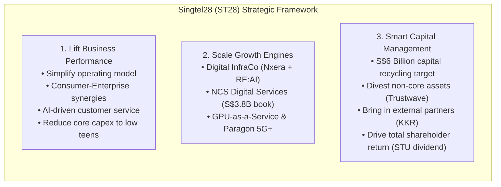

# Singtel: Operations, Business Model & Corporate Strategy Analysis

**Document Code:** SGT-INTEL-01-OPS  
**Classification:** Strategic Intelligence & Executive Briefing  
**Author:** Enterprise Research & Telecommunications Intelligence  
**Focus:** Corporate Architecture, Revenue Mechanics, Capital Recycling, and Singtel28 (ST28) Strategy  

---

## 1. Executive Summary & Corporate Identity

Singapore Telecommunications Limited (Singtel) is Asia's leading communications technology group. Founded in 1879, Singtel has evolved from a domestic government post and telegraph monopoly into a multinational telecommunications, infrastructure, and enterprise technology conglomerate with a presence spanning 21 countries across Asia-Pacific, Australia, the Middle East, and Africa, reaching over 780 million mobile subscribers.

Under Group CEO **Yuen Kuan Moon**, Singtel is executing a decisive pivot dubbed **Singtel28 (ST28)**—transitioning the group from a traditional utility telecom provider into a modern **Enterprise Technology and AI Infrastructure Powerhouse**.

```mermaid
graph TD
    SingtelGroup["Singtel Group (SGX: Z74)"]
    
    SingtelGroup --> SingtelSG["Singtel Singapore (Ng Tian Chong, CEO)"]
    SingtelGroup --> Optus["Optus Australia (100% Owned)"]
    SingtelGroup --> DigitalInfraCo["Digital InfraCo (Bill Chang, CEO)"]
    SingtelGroup --> NCS["NCS Group (Ng Kuo Pin, CEO)"]
    SingtelGroup --> RegionalAssociates["Regional Associates (Strategic Stakes)"]

    SingtelSG --> SGConsumer["Consumer Mobile, Broadband & TV"]
    SingtelSG --> SGEnterprise["Enterprise Business (B2B, CUBΣ, Paragon 5G+, QSN)"]

    DigitalInfraCo --> Nxera["Nxera Data Centres (DC Tuas 58MW, Johor 280MW)"]
    DigitalInfraCo --> REAI["RE:AI Sovereign GPU Cloud (NVIDIA GB300 / H100)"]
    DigitalInfraCo --> Subsea["Subsea Cables & Satellite Infrastructure"]

    NCS --> GovPlus["GovPlus (Singapore & Regional Public Sector)"]
    NCS --> TelcoPlus["Telco+ (Telecom IT Modernisation)"]
    NCS --> EnterpriseNEXT["NEXT Services (Digital, Cloud, Cyber, AI)"]

    RegionalAssociates --> Airtel["Bharti Airtel - India (27.5% Stake)"]
    RegionalAssociates --> Telkomsel["Telkomsel - Indonesia (30.1% Stake)"]
    RegionalAssociates --> AIS["AIS - Thailand (23.3% Stake)"]
    RegionalAssociates --> Globe["Globe - Philippines (46.8% Stake)"]
```

---

## 2. Core Operating Divisions

### 2.1 Singtel Singapore (Singtel SG)
* **Chief Executive:** Ng Tian Chong (appointed after integration of consumer and enterprise units)
* **Financial Contribution:** Generates approximately one-quarter of Singtel Group EBIT. FY24/FY25 Singapore revenue stands at **S$3.9 Billion**, with an industry-leading **EBITDA margin of 37%**.
* **Enterprise vs. Consumer Shift:** Enterprise services now account for **>50% of Singtel Singapore revenue**. While consumer mobile and broadband face saturated domestic competition, the enterprise market delivers high-margin recurring income through connectivity, cybersecurity, and digital infrastructure.
* **Market Dominance:**
  * **Domestic Data Revenue Market Share:** **84%** (IDC / Singtel Investor Day 2024)
  * **Fixed Broadband Revenue Market Share:** **46%**
  * **Mobile Market Share:** **~4.6 million** mobile subscribers (~45% market share)
  * **Asia-Pacific International IPVPN Share:** **19%** (excluding Japan)
  * **International Business Revenue:** **>S$500 Million** (int'l data, managed SD-WAN, and IoT roaming)
  * **Connected EV SIMs:** ~1 million embedded EV SIMs contracted across APAC across 13 global EV brands.

### 2.2 Digital InfraCo (Standalone Growth Engine)
* **Chief Executive:** Bill Chang (former CEO of Singtel Group Enterprise)
* **Mandate:** Carved out in mid-2023 to unbundle and monetize Singtel's core infrastructure assets and capture the exploding demand for artificial intelligence compute, subsea connectivity, and green data centres.
* **Core Subsidiaries:**
  1. **Nxera (Regional Data Centre Arm):**
     * **DC Tuas (Singapore):** 58MW state-of-the-art AI-ready facility; ultra-low Power Usage Effectiveness (PUE) < 1.25 with direct liquid-to-chip cooling (>100kW per rack).
     * **TM-Nxera (Johor, Malaysia):** 280MW AI-ready green campus in Iskandar Puteri (Johor-Singapore SEZ) developed in joint venture with Telekom Malaysia.
     * **Regional Pipeline:** High-density sites in Batam (Indonesia) and Bangkok (Thailand with AIS).
  2. **RE:AI (Sovereign AI Cloud):**
     * High-performance GPU-as-a-Service (GPUaaS) and Token-as-a-Service (TaaS).
     * First in APAC to deploy next-generation **NVIDIA DGX GB300 NVL72** systems alongside NVIDIA H100/H200 clusters.
     * Orchestrated through **Singtel Paragon**, delivering democratized access to sovereign compute without sending sensitive enterprise data offshore.
  3. **Subsea Cable & Satellite Network:**
     * Direct ownership and co-investment in key trans-oceanic backbones including **SEA-ME-WE 3, 4, 5, and 6**, **Asia Link Cable (ALC)**, and **Southeast Asia-Japan 2 (SJC2)** cable systems.
     * Critical landing stations in Singapore (Tuas, Katong) routing massive APAC traffic flows.

### 2.3 NCS (Technology & Digital Services Arm)
* **Chief Executive:** Ng Kuo Pin
* **Scale & Order Book:** Headquartered in Singapore with over 12,000 digital specialists across Asia-Pacific. Order bookings reached **S$3.8 Billion** in FY24/FY25, with revenue expanding by **10%** and EBIT surging by **16%**.
* **Specialist Units:**
  * **GovPlus:** Entrenched market leader for Singapore public sector IT modernization, civil service applications, and smart-nation infrastructure.
  * **Telco+:** Joint venture with Singtel and regional telcos to automate billing, OSS/BSS, and digital customer channels.
  * **NEXT Services:** End-to-end cloud migration, cyber defense, data engineering, and enterprise AI transformation for banks, logistics, and multinational corporations.

### 2.4 International Operations & Strategic Associates
Singtel derives substantial earnings and cross-border connectivity value from strategic regional associates:
* **Bharti Airtel (India - 27.5% Effective Stake):** India's premier communications provider serving >380 million subscribers. A crucial corridor partner for Singapore-India enterprise data links, data center colocation, and subsea landing rights.
* **Optus (Australia - 100% Owned):** Australia's second-largest telco (~10.5 million subscribers). Focus of operational turnaround following the 2022 breach and 2023 outage.
* **Telkomsel (Indonesia - 30.1% Stake):** Market leader in Indonesia with over 160 million mobile users.
* **AIS (Thailand - 23.3% Stake):** Premier telecommunications provider in Thailand.
* **Globe Telecom (Philippines - 46.8% Stake):** Leading mobile and digital network in the Philippines.
* **Bridge Alliance:** Consortium of 34+ leading mobile operators across APAC and Middle East, federating CAMARA open network APIs (SingVerify, SIM-swap, Scam Sniffing).

---

## 3. Financial Architecture & Singtel28 (ST28) Strategy

Singtel officially introduced **Singtel28 (ST28)** in May 2024 as the successor to its 2021 Strategic Reset.

### 3.1 Financial Targets & Capital Recycling
* **S$8 Billion Capital Already Recycled (2021-2024):** Monitised 1.6% of Bharti Airtel, sold Optus tower assets (Australia), partially monetized NetLink Trust, and divested loss-making non-core subsidiaries (Trustwave).
* **New S$6 Billion Pipeline (ST28):** Additional capital recycling identified from secondary assets to fund high-growth AI and data centre infrastructure without overburdening group balance sheet leverage.
* **KKR Partnership Model:** Singtel brought KKR in as a strategic partner:
  * S$1.1 Billion KKR investment in Nxera for a 20% equity stake (valuing Nxera at S$5.5 Billion).
  * S$13.8 Billion consortium buyout of **STT GDC** (KKR 75%, Singtel 25%).
* **Capex Discipline:** Target capex-to-revenue ratio reduced from 15% to **low teens** beyond FY26 as 5G network buildouts reach national maturity in Singapore.

---

## 4. The Enterprise Revenue Engine: Why Singtel Wins in B2B

Singtel's enterprise revenue model has transformed from selling basic bandwidth ("dumb pipes") into a high-margin, multi-tiered subscription and managed services ecosystem:

| Revenue Stream | Typical Pricing Model | Enterprise Customer Need | Stickiness / Retention |
| :--- | :--- | :--- | :--- |
| **Core Domestic & Int'l Connectivity (SingNet eVolve, Meg@POP, Gigawave)** | Monthly recurring charge (MRC) on 24–36 month contracts | Dedicated point-to-point fiber, international IPVPN, cloud interconnections | High. Replacing physical enterprise fiber routes incurs substantial migration costs. |
| **Singtel CUBΣ (NaaS Portal)** | Platform subscription + usage-based network orchestration | Single-pane management of SD-WAN, multi-cloud interconnects, bandwidth-on-demand, and network AIOps | Very High. Acts as the customer's central operational pane for global connectivity. |
| **Singtel Paragon (5G+ Edge)** | Platform licence + 5G slice fees + partner application margins | Port automation (PSA), smart manufacturing, airport tarmac telemetry (Changi T3), medical robotics | Extreme. Deeply embedded into the client's operational physical plant. |
| **RE:AI Sovereign GPU Cloud (TaaS & GPUaaS)** | Consumption-based (tokens / API calls) or reserved GPU-hours (NVIDIA DGX GB300 / H100) | Local LLM inference, sensitive banking/healthcare AI workloads, sovereign regulatory compliance | Moderate to High. Customers avoid hyperscaler lock-in while maintaining data residency. |
| **Cybersecurity & Quantum-Safe Network (QSN)** | Managed security service fees (MSSP) + encrypted link surcharges | Protecting critical information infrastructure (CII) against nation-state APTs, post-quantum crypto | Critical. Mandated by MAS TRM and CSA Cybersecurity Code of Practice. |
| **NCS Managed Cloud & Systems Integration** | Milestone-based project fees + multi-year managed services contracts | Government portal engineering, ERP cloud migration, custom enterprise applications | Very High. Contracts typically span 3–7 years. |
