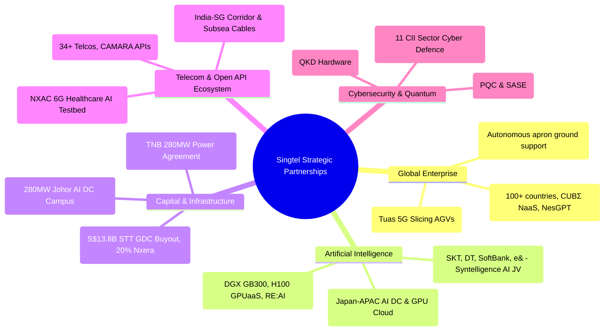

# Singtel: Major Strategic & Enterprise Partnerships Dossier

**Document Code:** SGT-INTEL-02-PARTNERS  
**Classification:** Strategic Intelligence & Executive Briefing  
**Focus:** Landmark Enterprise Contracts, Global Alliances, Technology Ecosystems, and Capital Partnerships  

---

## 1. Executive Summary

Singtel's enterprise transformation relies heavily on high-leverage partnerships across four distinct domains:
1. **Global Enterprise Modernisation:** Securing Fortune/Forbes Global 50 enterprises (e.g., Nestlé) to manage worldwide multi-cloud networks through software-defined orchestration (**Singtel CUBΣ**).
2. **Artificial Intelligence & Compute Alliances:** Teaming up with global market leaders like **NVIDIA** (first in APAC to deploy DGX GB300 systems), **Hitachi**, and the **Global Telco AI Alliance (GTAA)** to deploy sovereign compute infrastructure and specialized telecom foundation models.
3. **Digital Infrastructure & Capital Consortiums:** Partnering with premier private equity giant **KKR** to fund capital-intensive data centre expansions, culminating in the **S$13.8 Billion acquisition of STT GDC** and the **280MW TM-Nxera campus in Johor**.
4. **Mission-Critical Co-Engineering:** Partnering with **Ericsson**, **NUHS**, **CSA**, **Palo Alto Networks**, and **Fortinet** to deploy next-generation 5G-Advanced, Quantum-Safe Networks (QSN), and Operational Technology (OT) cyber defence.

---

## 2. Landmark Enterprise Modernisation: The Nestlé Global Network Deal

### 2.1 The Deal Profile
* **Client:** Nestlé (Forbes Global 50 multinational, world's largest food and beverage conglomerate).
* **Scope:** Modernisation of Nestlé's global communications backbone across **100+ countries**, connecting over **1,700 sites and 350 factories worldwide**, ranging from major corporate offices to rural sourcing facilities.
* **Core Technology:** **Singtel CUBΣ (Cube)** Network-as-a-Service (NaaS) orchestration platform.
* **Architectural Pivot:** Migrating Nestlé away from rigid, legacy Multi-Protocol Label Switching (MPLS) private lines to a dynamic, software-defined, multi-cloud and internet-centric SD-WAN architecture.

### 2.2 Strategic Value & Capabilities
* **Single Pane of Glass Orchestration:** Singtel CUBΣ allows Nestlé IT to centrally manage, monitor, and configure diverse multi-vendor network circuits (MPLS, dedicated internet, 4G/5G, and Low Earth Orbit / LEO satellite links) through an intuitive digital portal.
* **Real-Time Enterprise AI (NesGPT):** The modernized network provides the high-bandwidth, ultra-reliable transmission backbone required for **NesGPT**—Nestlé's secure internal generative AI application accessed by more than 80,000 employees globally.
* **Performance Gains:** Achieved an estimated **40% increase in network performance efficiency**, reduced branch onboarding time from weeks to hours, and enabled real-time supply chain transparency ("farm-to-fork" traceability).
* **Sales Takeaway for Singtel:** Demonstrates Singtel's ability to win against traditional global telecom giants (such as AT&T, Orange Business, and BT) in massive, complex multinational competitive tenders.

---

## 3. Artificial Intelligence & Compute Partnerships

### 3.1 NVIDIA Partnership & RE:AI (GPUaaS & TaaS)
* **Milestone:** In October 2024 / 2026, Singtel announced that its sovereign AI cloud platform, **RE:AI**, became the **first in the Asia-Pacific region to deploy next-generation NVIDIA DGX GB300 NVL72** systems.
* **Leadership:** Spearheaded by **Bill Chang**, CEO of Singtel Digital InfraCo.
* **Core Product Tiers:**
  1. **GPU-as-a-Service (GPUaaS):** Dedicated, high-performance compute clusters (NVIDIA GB300 and H100) hosted at **Nxera DC Tuas (58MW)** with liquid-cooling infrastructure (>100kW per rack) for training and fine-tuning large models.
  2. **AI Token-as-a-Service (TaaS):** A fully managed inference platform providing consumption-based, pay-per-token access to top foundation models. Designed to eliminate infrastructure overhead and mitigate the high cost of overseas API calls while guaranteeing domestic data residency.
* **Edge Integration via Singtel Paragon:** Enterprise clients can orchestrate AI workloads across edge devices (cameras, robotics) and RE:AI GPU clusters using a single API and control plane.

### 3.2 Global Telco AI Alliance (GTAA) & Syntelligence AI Joint Venture
* **Founding Members:**
  1. **Singtel Group** (Singapore / Southeast Asia / Australia)
  2. **SK Telecom** (South Korea)
  3. **Deutsche Telekom** (Germany / Europe / US)
  4. **e& Group** (Middle East / Africa)
  5. **SoftBank Corp.** (Japan)
* **Combined Reach:** Over **1.3 Billion mobile and enterprise subscribers** across 50+ countries.
* **The Commercial Entity:** The members formed a joint venture operating under the corporate brand **Syntelligence AI**, launched with an initial **US$37.5 Million** capital injection, led by CEO Prateek Choudhary.
* **Core Mission:**
  * **Multilingual Telco Foundation Models:** Building domain-specific Large Language Models (LLMs) pre-trained on telecommunications, billing, and network operations terminology in English, Korean, German, Japanese, and Arabic.
  * **Telecom Network Fraud Prevention:** Network-level AI detection against fraudulent voice traffic, voice phishing, and SIM spoofing.
  * **Automated Customer Care:** Autonomous digital customer concierges capable of handling complex account requests without human intervention.

### 3.3 Hitachi Strategic Agreement (Japan & APAC AI Expansion)
* **Announcement:** Strategic partnership between Singtel and Hitachi, Ltd. to co-develop sustainable, AI-ready data centres and GPU cloud platforms across Japan and the broader Asia-Pacific region.
* **Focus:** Integrating Hitachi's industrial automation, energy management, and cooling technologies with Singtel's Nxera DC architecture and RE:AI platform to deliver high-efficiency AI infrastructure.

---

## 4. Digital Infrastructure & Capital Partnerships

### 4.1 KKR Consortium & The S$13.8 Billion STT GDC Acquisition
* **June 2024 Initial Tranche:** KKR and Singtel formed an investment consortium, injecting **S$1.75 Billion (~US$1.3 Billion)** into ST Telemedia Global Data Centres (STT GDC) via Redeemable Preference Shares with detachable warrants—Southeast Asia's largest digital infrastructure deal of 2024.
* **Full Buyout Follow-Up:** The consortium signed definitive agreements to acquire the remaining 82% stake from ST Telemedia for **S$6.6 Billion (US$5.1 Billion)**, valuing the entire STT GDC platform at an implied enterprise value of **S$13.8 Billion (US$10.9 Billion)**.
* **Post-Deal Ownership Structure:**
  * **KKR:** 75% equity ownership
  * **Singtel:** 25% equity ownership
* **Strategic Assets Acquired:**
  * Over **2.3 Gigawatts (GW)** of gross data centre capacity globally across 11 geographic markets.
  * Crucially for the Singapore-India corridor: **STT GDC India operates 34 operational data centres with 613MW of IT capacity across 10 Indian cities** (Mumbai, Bengaluru, Chennai, Delhi NCR, Pune, Hyderabad, Kolkata, Ahmedabad), including a newly commissioned 22MW AI data centre in Noida.
* **Nxera Direct Equity:** KKR also invested **S$1.1 Billion** directly into Singtel's **Nxera** data centre unit for an initial 20% stake, establishing an enterprise valuation of S$5.5 Billion for Nxera.

### 4.2 Telekom Malaysia (TM) & The 280MW TM-Nxera Johor Campus
* **Joint Venture:** TM Nxera Sdn Bhd (51% Telekom Malaysia, 49% Singtel Nxera).
* **Location:** Iskandar Puteri, Johor, situated inside the **Johor-Singapore Special Economic Zone (JS-SEZ)**, approximately 25 kilometers from the Singapore border.
* **Power Agreement:** Secured a long-term electricity supply agreement with Malaysia's national power utility, **Tenaga Nasional Berhad (TNB)**, for **280 Megawatts** of dedicated power.
* **Design & Phasing:**
  * High-density liquid cooling capable of supporting extreme AI workloads (>100kW per rack).
  * Design Power Usage Effectiveness (PUE) target of **$\le 1.30$** at full operational load.
  * Groundbreaking completed in July 2024; topping-out of Building 1 accomplished in April 2026; initial commercial phase (64MW) scaling towards 200MW+.
* **Corridor Synergy:** Connected to Singtel's Singapore infrastructure via diverse subsea and terrestrial fiber rings, enabling Singaporean enterprises to deploy heavy AI training clusters in Johor while keeping low-latency inference nodes in Singapore.

---

## 5. Telecom Ecosystem & Cross-Border Alliances

### 5.1 Bridge Alliance & Open Gateway CAMARA Federation
* **Overview:** Singtel is a founding member of Bridge Alliance, a partnership of **34 leading mobile network operators** across Asia-Pacific and the Middle East.
* **API Federation:** Singtel launched its suite of open network APIs (**SingVerify**) aligned with the GSMA Open Gateway / CAMARA global standards, federating across Bridge Alliance members:
  * **Number Verify:** Instant cryptographic mobile identity authentication eliminating SMS OTP interception.
  * **Device Location:** Real-time carrier-grade verification of user device proximity to flag unauthorized cross-border transactions.
  * **SIM-Swap Detection:** Real-time status checking alerting banks if an account's SIM card was swapped within the preceding 24–72 hours.
  * **Scam Sniffer:** AI-driven network telemetry flagging suspicious calling numbers and fraudulent SMS routes.
* **Regional Cross-Federation:** Singtel federated these APIs locally with **M1** in Singapore, and regionally with **Maxis** (Malaysia) and **AIS** (Thailand), enabling multinational banks and e-commerce platforms to deploy a single API across Southeast Asia.

### 5.2 Bharti Airtel (India-Singapore Strategic Corridor)
* **Equity Tie-Up:** Singtel owns an effective **27.5% stake** in Bharti Airtel, India's leading digital communications group.
* **Infrastructure Interconnect:**
  * Joint landing rights and routing on the **SEA-ME-WE 6** and **Asia Link Cable (ALC)** trans-oceanic subsea cable systems.
  * Last-mile domestic enterprise delivery across India: Singtel enterprise clients expanding to Bengaluru, Mumbai, Pune, or Gurugram receive guaranteed local fiber tails and MPLS circuits delivered through Airtel Business.
  * Regulatory Compliance: Pre-engineered architectures enabling Indian and Singaporean MNCs to satisfy **RBI Data Localization** and India's **Digital Personal Data Protection (DPDP) Act 2023** by keeping primary data on Indian soil (STT GDC/Airtel) while replicating tokenized data vectors to Singapore via Singtel optical links.

### 5.3 Ericsson & NUHS: World's First 6G Healthcare AI Testbed (NXAC)
* **Announcement:** November 3, 2026.
* **Partners:** **National University Health System (NUHS)**, **Singtel**, and **Ericsson**.
* **Project:** National University XG AI Centre (**NXAC**)—the world's first translational 5G-Advanced and 6G hospital AI centre.
* **Use Cases:**
  * Autonomous mobile hospital transport robots operating over dedicated 5G priority slices.
  * Ambient spatial intelligence for continuous clinical patient monitoring.
  * Ultra-low-latency augmented reality (XR) surgical navigation and remote consultation.

---

## 6. Singtel Paragon 5G+ Ecosystem Partners

Singtel has pre-integrated specialized Independent Software Vendors (ISVs) directly into its **Singtel Paragon** orchestration marketplace, enabling reps to sell complete end-to-end industry solutions:

| Partner | Solution Domain | Real-World Deployment | Value Proposition |
| :--- | :--- | :--- | :--- |
| **Cosmiqo IRIS** | Computer vision & AI video analytics | Tuas Mega Port & Industrial Campuses | Edge AI image processing with zero cloud transmission latency. |
| **DataMesh FactVerse** | Industrial digital twins & mixed reality | Kajima THE GEAR & Construction Sites | Live 3D BIM synchronization over low-latency 5G network slices. |
| **Garuda Robotics** | Autonomous drone-in-a-box orchestration | Critical infrastructure & security patrols | BVLOS (Beyond Visual Line of Sight) drone flight control over 5G. |
| **RansNet** | SD-Branch & captive portal management | Hospitality, retail chains & branch offices | Seamless branch Wi-Fi and SD-WAN deployment through CUBΣ. |
| **Axis Communications** | High-definition networked video security | Smart urban hubs & perimeter surveillance | Native 5G cameras transmitting encrypted 4K streams with zero cabling. |
| **RealWear** | Industrial assisted-reality headsets | Field maintenance, aviation hangars (Changi) | Hands-free remote expert video calling in hazardous industrial plants. |
| **Eviden / Atos** | High-performance enterprise edge AI | Smart manufacturing plants | Sovereign edge compute appliances managed through Paragon. |
