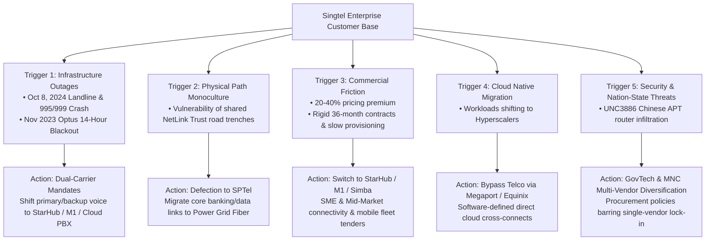
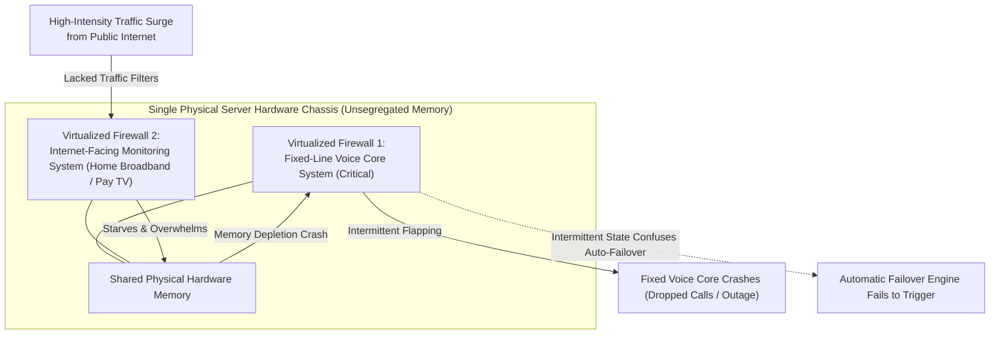

# Singtel: Client Departures, Account Churn & Competitive Defections Analysis

**Document Code:** SGT-INTEL-03-CHURN  
**Classification:** Strategic Intelligence & Forensic Churn Analysis  
**Focus:** Incident Forensics, Root Causes of Enterprise Defection, Structural Vulnerabilities, and Competitor Migration Paths  

---

## 1. Executive Summary

While Singtel maintains an 84% revenue market share in domestic enterprise data and 46% in fixed broadband, the group faces continuous and accelerating **enterprise churn risks**. In modern telecommunications, enterprise defection rarely occurs through sudden consumer-style contract cancellations; rather, it manifests through **account erosion**, **dual-carrier diversification**, and **architectural bypasses**:
1. **Critical Outage Catastrophes:** The catastrophic **October 8, 2024 fixed voice disruption** (which crippled 995/999 emergency hotlines, major hospital call centres, and bank branch systems) triggered board-level mandates across healthcare and banking to eliminate single-carrier Singtel dependencies.
2. **Physical Infrastructure Vulnerability & The SPTel Exodus:** Enterprises requiring genuine physical path diversity have actively shifted secondary and primary circuits to **SPTel** (ST Engineering & SP Group), whose fiber runs through Singapore's underground electrical power grid, completely bypassing Singtel and NetLink Trust road trenches.
3. **Cloud Native Interconnect Bypasses:** Enterprises migrating enterprise workloads to AWS, Microsoft Azure, and Google Cloud have systematically abandoned expensive telco-managed IPVPN/MPLS contracts in favour of software-defined interconnection fabrics (**Megaport**, **Equinix Fabric**).
4. **Price-Led Mid-Market & SME Defections:** Aggressive multi-product discounting by **StarHub**, **M1**, and **Simba** has eroded Singtel's margins, causing price-sensitive accounts to churn due to Singtel's 20%–40% price premium and rigid 36-month contracts.
5. **Brand Damage from Catastrophic Incidents:** The twin disasters at Singtel's Australian subsidiary Optus (the September 2022 breach of 9.8 million records and the November 2023 14-hour blackout) sparked mass enterprise customer flight to Telstra.

---

## 2. Forensic Breakdown: The October 8, 2024 Landline Catastrophe

### 2.1 Timeline & Scope of Disruption
* **Date & Duration:** Tuesday, 8 October 2024. Commenced at approximately 1:54 PM and persisted for more than four hours into the evening.
* **Scale:** Impacted approximately **500,000 residential and enterprise fixed-line subscribers** across Singapore.
* **Critical Services Crippled:**
  * **National Emergency Hotlines:** Complete failure of the Singapore Civil Defence Force (**995** emergency fire and ambulance service) and Singapore Police Force (**999** police hotline). SCDF and SPF were forced to push nationwide emergency SMS broadcasts instructing the public to send text messages to **70995** and **70999** or use alternative mobile numbers.
  * **Healthcare Clusters:** Patient appointment hotlines, emergency room communications, and internal PBX phone systems at major public healthcare clusters (**SingHealth**, **Tan Tock Seng Hospital**, **Singapore General Hospital**, **KK Women's and Children's Hospital**) crashed completely.
  * **Banking & Financial Institutions:** Customer service hotlines, branch telephone lines, and point-of-sale (POS) settlement links across Singapore's major banks (**DBS**, **OCBC**, **UOB**) suffered severe operational disruption.

### 2.2 Technical Root Cause (IMDA Investigation Findings)
Following a comprehensive technical investigation, the **Infocomm Media Development Authority (IMDA)** imposed a **S$1.0 Million financial penalty** on Singtel, determining that the incident was fully within Singtel's power to prevent:

1. **Unsegregated Co-Hosting on Shared Memory:** Singtel hosted two separate virtualized firewalls on the exact same physical hardware chassis:
   * Virtualized Firewall A: Handled the mission-critical fixed-line voice core network.
   * Virtualized Firewall B: Handled an internet-facing monitoring and telemetry system for residential broadband routers and Pay TV set-top boxes.
2. **Lack of Traffic Filtering:** Virtualized Firewall B lacked adequate rate-limiting and defensive filters to shield the hardware from high-intensity internet traffic surges.
3. **Hardware Memory Contention:** A sudden surge in external telemetry traffic overwhelmed the shared physical memory pool, causing the fixed-line voice firewall to starve, crash, and operate intermittently.
4. **Flapping & Failed Automatic Failover:** Because the voice firewall was operating intermittently ("flapping") rather than experiencing a clean, hard failure, Singtel's automated site-failover mechanism failed to recognize the outage condition and did not redirect traffic to the secondary standby facility. Traffic had to be rerouted manually hours later.

### 2.3 The Customer Fallout & Defections
* **Healthcare De-Risking:** Hospital boards initiated emergency reviews of their telecommunications infrastructure. Both public and private hospital operators mandated that mission-critical patient hotlines and trauma centre lines could no longer rely exclusively on Singtel SIP trunks, accelerating migration to **dual-active SIP trunks split 50/50 between Singtel and StarHub**, while moving administrative voice to cloud platforms like **Microsoft Teams Phone**.
* **Banking SLA Breaches:** Major financial institutions experienced significant regulatory scrutiny from the **Monetary Authority of Singapore (MAS)** under the **Technology Risk Management (TRM)** Guidelines, which mandate high-availability and zero single points of failure. Several foreign investment banks and trading firms invoked SLA penalty clauses against Singtel and transferred secondary communication lots to alternative providers.

---

## 3. Structural Defection: The Physical Path Monoculture & The SPTel Threat

### 3.1 The NetLink Trust Vulnerability
In Singapore, the vast majority of commercial fiber lines delivered by Singtel, StarHub, and M1 rely on passive fiber ducts and manholes owned by **NetLink Trust (NLT)** running beneath roadside pavements.
* **The "Shared Trench" Problem:** Many enterprise CIOs believed they had achieved high availability by buying a primary line from Singtel and a "backup" line from StarHub or M1.
* **The Reality:** When a roadside construction excavator or underground drilling contractor accidentally slices through a physical cable duct, **both Singtel and StarHub lines are severed simultaneously**.

### 3.2 Why Critical Accounts Switched to SPTel
**SPTel** (a joint venture between **ST Engineering** and **SP Group**) entered the enterprise market specifically to exploit this structural weakness:
1. **Power Grid Route Diversity:** SPTel lays its optical fiber alongside **SP Group's underground electrical power grid infrastructure**, completely separate from public roadside telecommunications ducts.
2. **True Air-Gapped Physical Redundancy:** A roadside contractor cutting a NetLink Trust telecommunications trench has zero impact on SPTel's power-grid-embedded fiber.
3. **Software-Defined Agility:** SPTel built an agile, software-defined network (SDN) allowing customers to burst bandwidth on demand via an online portal in minutes, contrasting sharply with Singtel's legacy manual provisioning cycles (often requiring 4 to 8 weeks).
4. **Customer Loss Impact:** Tier-1 financial institutions (e.g., quantitative trading firms, regional settlement hubs), critical semiconductor fabrication plants in Woodlands and Pasir Ris, and sovereign entities transferred secondary and disaster-recovery circuits from Singtel to SPTel to guarantee 100% physical route diversity.

---

## 4. Cloud Interconnect Erosion: The Hyperscaler Bypass

Historically, Singtel generated lucrative enterprise revenues by selling dedicated **Meg@POP IPVPN** and **Optical Gigawave** point-to-point circuits connecting enterprise data centres to branch offices and private server racks.

### 4.1 The Mechanism of Disintermediation
As Singapore enterprises aggressively migrated internal workloads to **Amazon Web Services (AWS)**, **Microsoft Azure**, and **Google Cloud Platform (GCP)**, the networking topology fundamentally shifted:
* Enterprises no longer required private telco-managed IPVPN meshes between multiple branch offices.
* Instead, they required high-bandwidth, direct virtual cloud cross-connects (AWS Direct Connect, Azure ExpressRoute).
* Software-defined interconnection providers like **Megaport**, **Equinix Fabric**, and **Console Connect** began offering virtual point-to-cloud connections provisionable in seconds through an API, with billing by the hour or month.
* **Result:** Rather than paying Singtel S$5,000–S$15,000 per month for a rigid 3-year managed IPVPN link, enterprise IT departments purchased carrier-neutral port connections from Megaport or Equinix for a fraction of the cost, eroding Singtel's domestic data revenue.

---

## 5. Commercial Friction: Pricing, Bureaucracy & Rigid Contracts

Enterprise interviews, procurement audits, and hackathon account records highlight recurring operational pain points that cause enterprise customers to churn to competitors:

| Customer Pain Point | Singtel Legacy Practice | Competitor Advantage (StarHub / M1 / Simba) | Resulting Churn Behavior |
| :--- | :--- | :--- | :--- |
| **Pricing Premium** | Singtel connectivity and DIA (Dedicated Internet Access) priced **20% to 40% higher** than market competitors. | StarHub and M1 aggressively undercut prices in enterprise tenders to win logo share. | Price-sensitive mid-market firms and SMEs switch wholesale during 3-year contract renewal windows. |
| **Contract Rigidity** | Rigid 24- to 36-month minimum term contracts with stiff early-termination penalties (often 100% of remaining contract value). | Flexible 12-month terms, co-termed add-ons, and burstable bandwidth pricing. | Customers feel trapped; procurement teams issue competitive RFPs 9 months before renewal to force price concessions or exit. |
| **Provisioning Velocity** | Complex provisioning workflows requiring physical site surveys and legacy OSS/BSS scheduling taking **60 to 90 days**. | Agile provisioning within 10 to 15 business days; pre-provisioned on-net ports. | High-growth startups, expanding fintechs, and foreign MNCs setting up regional offices choose competitors who can turn on circuits immediately. |
| **Fragmented Account Coverage** | Sales organization historically fragmented into disconnected silos: Connectivity rep, Cyber specialist, Cloud rep, and NCS team. | Single unified account director empowered to quote across all technology layers. | Customer frustration with coordinating four different sales reps and receiving four separate invoices with conflicting SLAs. |
| **Regional Partner Tail Blind Spots** | Singtel relies on local partner tail circuits in Malaysia, India, or China with weak cross-border SLA pass-through. | Regional telcos (e.g., Tata Comms in India, TM in Malaysia) provide native last-mile infrastructure with direct SLAs. | Customers experiencing packet loss on overseas branches bypass Singtel and contract directly with in-country local carriers. |

---

## 6. The Optus Catastrophes: International Subsidiary Churn

Singtel's wholly owned Australian subsidiary, **Optus**, serves as a stark case study in how technical failures and cyber breaches precipitate catastrophic enterprise and consumer customer flight.

### 6.1 The September 2022 Cyber Breach
* **Event:** An unsecured, internet-facing Application Programming Interface (API) allowed an attacker to scrape the personal details of approximately **9.8 million current and former Optus customers** (~40% of Australia's population), including passport numbers, driver's licenses, and Medicare IDs.
* **Consequences:**
  * Massive reputational collapse and class-action lawsuits.
  * Direct pre-tax provisions of S$140+ Million for customer support, ID replacement, and independent forensic reviews.
  * Acceleration of corporate and government accounts moving their mobile fleets and data contracts to **Telstra**.

### 6.2 The November 8, 2023 Nationwide Outage
* **Event:** A catastrophic 14-hour nationwide network collapse commencing at 4:05 AM. Disconnected **10.2 million individuals and over 400,000 businesses**.
* **Societal & Economic Impact:**
  * Paralyzed the Melbourne metro train communications network, stranding hundreds of thousands of morning commuters.
  * Hospital phone lines went dark; healthcare workers were unable to communicate with emergency response units.
  * Inability of EFTPOS card terminals to process transactions caused tens of millions of dollars in retail losses.
* **Fallout:**
  * Chief Executive Officer **Kelly Bayer Rosmarin** resigned in disgrace under intense federal parliamentary and public pressure.
  * Wholesale defection of Australian corporate clients, government tenders, and SME fleets to Telstra and TPG Telecom.

---

## 7. Nation-State Cybersecurity Threat: UNC3886 Infiltration

In November 2024, an investigative report published by *Bloomberg* revealed that **Singtel's core telecommunications infrastructure had been breached in June 2024 by sophisticated Chinese state-sponsored hackers**:
* **Threat Actor Attribution:** Tracked by cybersecurity intelligence firms (such as Mandiant / Google Cloud) as **UNC3886** (an advanced persistent threat group linked to China) and associated with the wider "Volt Typhoon" cyber-espionage nexus.
* **Modus Operandi:** The attackers exploited zero-day vulnerabilities in routers, enterprise firewalls, and virtualization platforms, planting web shells in "listening mode" to establish stealthy, persistent backdoors into Southeast Asian critical infrastructure.
* **Enterprise Repercussions:**
  * Alarmed government defence bodies and multinational banking clients handling sensitive intellectual property.
  * Demonstrated that traditional perimeter defense is insufficient against state-backed threat actors, accelerating Singtel's pivot to **Post-Quantum Cryptography (PQC)**, **Quantum Key Distribution (QKD)**, and the **DART OT/IT Cyber Defence** initiative to rebuild institutional trust.
