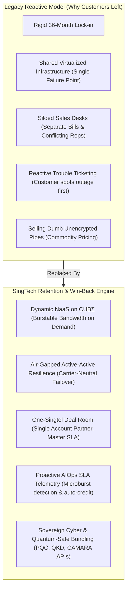
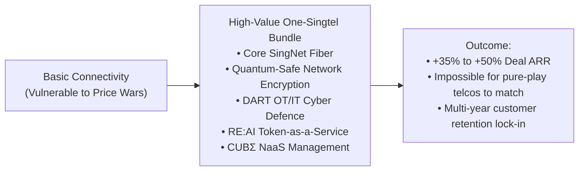

# Singtel: Customer Retention, Outage Prevention & Win-Back Playbook

**Document Code:** SGT-INTEL-04-RETENTION  
**Classification:** Strategic Sales Playbook & Engineering Framework  
**Focus:** Proactive Account Protection, Anti-Churn Architectures, Commercial Agility, and Multi-Pillar Bundling  

---

## 1. Executive Summary: What Could Have Been Done to Keep Them

The defection of enterprise clients to competitors like **StarHub**, **SPTel**, **M1**, and **Megaport** was not inevitable. An analysis of lost accounts and procurement disputes reveals that clients left Singtel primarily due to:
* **Perceived single-point-of-failure vulnerabilities** (dramatized by the 8 October 2024 outage).
* **Commercial inflexibility** (rigid 36-month contracts, slow provisioning cycles, premium pricing).
* **Internal organizational fragmentation** (siloed sales desks for connectivity, cloud, cyber, and NCS).
* **Reactive customer support** (waiting for customers to complain about latency micro-bursts or outages).

To stop enterprise churn, protect core domestic data revenue, and win back lost logos, Singtel must transition from a reactive connectivity seller into a **Proactive Digital Infrastructure Partner**.



---

## 2. Technical Architecture: Preventing Outages & Eliminating Single Points of Failure

### 2.1 Strict Compute & Memory Isolation (The Lesson of 8 October 2024)
* **The Error:** Singtel co-hosted the virtualized firewall for its fixed-line voice core network on the exact same physical server and shared memory as an internet-facing monitoring tool.
* **The Required Fix:**
  * **Zero Co-Tenancy for Mission-Critical Services:** Telecommunications core voice, financial trading links, and healthcare emergency hotlines must run on dedicated, physically isolated compute appliances or dedicated hardware security modules (HSMs).
  * **Aggressive Upstream Ingress Filtering:** Internet-facing monitoring telemetry must pass through distributed stateless DDoS scrubbing and rate-limiting filters (e.g., eBPF-based packet filters) before hitting hypervisors.
  * **Deterministic Failover Triggers:** Redesign the health-check monitors in automated failover engines. Instead of relying solely on binary link-up/link-down signals, the system must trigger an immediate failover when packet latency exceeds 10ms or when memory allocation exceeds 80% for more than 15 seconds ("flapping protection").

### 2.2 Active-Active Dual-Path Routing via Singtel CUBΣ
To counter the threat of **SPTel's power-grid fiber**, Singtel must deliver true network diversity at the routing and orchestration layer:
* **Carrier-Neutral SD-WAN Orchestration:** Through **Singtel CUBΣ**, Singtel should provision and manage both the primary Singtel fiber link and a secondary alternative circuit (which can even be a third-party dark fiber link like SPTel or a 5G fixed-wireless backup) inside a single managed router.
* **Sub-Second BGP Session Failover:** If a physical fiber cut occurs in a roadside trench, BGP multipath routing shifts application traffic across the alternate path in **under 50 milliseconds**, ensuring that active SIP voice calls, banking transactions, and clinical data transfers never drop.
* **5G Network Slicing as Instant Failover:** Deploy **Singtel Paragon 5G+ Priority Slicing** as an automatic tertiary failover for branch offices and ATMs. If fixed broadband lines are severed, the site automatically switches to an encrypted 5G enterprise slice with guaranteed Quality of Service (QoS).

---

## 3. Commercial Agility: Dismantling Contract Friction

To counter aggressive pricing and agility advantages from **StarHub**, **M1**, and **Megaport**, Singtel must overhaul its commercial packaging:

### 3.1 Network-as-a-Service (NaaS) Bandwidth-on-Demand
* **Problem:** Customers resent paying for 10Gbps year-round when their normal load is 2Gbps, or waiting 60 days to upgrade bandwidth.
* **Solution:** Deliver dynamic bandwidth scaling through the **Singtel CUBΣ Portal**:
  * Enterprises maintain a flexible baseline commitment (e.g., 2Gbps).
  * During peak operational events (e.g., monthly banking settlements, seasonal e-commerce sales, hospital imaging batch syncs), the IT director can burst bandwidth up to 10Gbps with 3 clicks in the portal.
  * Billing is consumption-based (hourly or daily burst rates), matching the elasticity of hyperscalers like AWS.

### 3.2 14-Day Pre-Cleared Pilot Sandboxes
* Enterprise procurement teams are risk-averse. Singtel should offer standard **14-day pre-cleared proof-of-concept (POC) sandboxes** for high-value services:
  * **RE:AI Token-as-a-Service (TaaS) Sandbox:** 50,000 complimentary AI inference tokens pre-configured on sovereign NVIDIA clusters.
  * **Quantum-Safe Network (QSN) Pilot:** 14-day encrypted tunnel testbed connecting the client's primary data centre to their disaster recovery site.
  * Eliminates procurement gridlock and lets the technical champion validate performance before signing the master agreement.

---

## 4. Proactive SLA Telemetry & Account Retention

The biggest driver of enterprise defection is the feeling that Singtel is indifferent until contract renewal time. SingTech automates proactive account care:

```mermaid
sequenceDiagram
    autonumber
    actor Customer as Enterprise IT Director
    participant CUBE as Singtel CUBΣ AIOps
    participant SingTech as SingTech Sales Copilot
    participant Rep as Singtel Client Partner

    CUBE->>SingTech: Alert: Hong Kong trading link experienced 4.2ms microburst jitter at 9:02 AM
    SingTech->>SingTech: Match Account: LionRock Quantitative Bank (Contract renewal in 60 days)
    SingTech->>SingTech: Generate Proactive Remediation Plan & SGD 2,400 Service Credit Voucher
    SingTech->>Rep: Push High-Priority Action Card: "Contact LionRock CIO before they review outage report"
    Rep->>Customer: Executive Outreach: "We detected microburst latency this morning, automated path shift executed, SGD 2,400 credited to invoice, proposing QSN latency upgrade."
    Customer->>Rep: High Satisfaction: "Impressed by proactive catch; approve QSN latency upgrade paper."
```

### 4.1 Automated Microburst Detection
* High-frequency trading firms, container terminals, and cloud software firms cannot tolerate packet loss or latency jitter.
* Singtel CUBΣ's telemetry engine tracks microbursts and network strain at millisecond granularity.
* When telemetry detects link saturation exceeding **85% capacity** or latency deviating from the contracted SLA (e.g., exceeding 1.5ms on a Singapore-Hong Kong trading route), it automatically flags the account in SingTech.

### 4.2 Proactive Service Credits & Account Outreach
* Rather than waiting for the customer to discover the degradation at the end of the month and demand a refund, Singtel automatically applies a service credit to the next billing cycle.
* The Client Partner receives an automated outreach brief in SingTech explaining the technical anomaly, the corrective routing action taken, and a recommended architectural upgrade (e.g., upgrading from standard IPVPN to dedicated **Optical Gigawave 100Gbps**).

---

## 5. Organizational Unity: The "One-Singtel" Multi-Disciplinary Deal Room

### 5.1 Dismantling Divisional Silos
Historically, enterprise clients had to interact with four distinct Singtel sales groups:
1. Singtel Enterprise Connectivity (fiber and mobile plans)
2. Cybersecurity specialists (formerly Trustwave)
3. Cloud and Data Centre team (Nxera / RE:AI)
4. NCS systems integrators (digital applications)

This resulted in disjointed pitches, finger-pointing during service disruptions, and bureaucratic invoicing delays.

### 5.2 The Unified Deal Room Solution
* **Single Account Ownership:** The Client Partner acts as the single point of contact, orchestrating solutions across all four divisions.
* **Unified Master Services Agreement (MSA):** All four pillars are bundled under a single master contract with harmonized terms, cross-product discounts, and unified SLA commitments.
* **Multi-Pillar Strategic Bundling:** When a competitor like StarHub attempts to undercut Singtel on basic fiber pricing, the Singtel Client Partner counters not by discounting bandwidth, but by bundling high-margin services that StarHub cannot match:



---

## 6. Win-Back Strategy for Lost Accounts

For accounts that have already shifted circuits to competitors (such as StarHub, M1, or SPTel), Singtel should execute a targeted **3-Stage Win-Back Campaign**:

| Win-Back Stage | Timeframe | Action & Value Proposition | Target Accounts |
| :--- | :--- | :--- | :--- |
| **Stage 1: The Regulatory & Compliance Hook** | Immediate (Day 1–30) | Approach the CISO/Risk Officer with a **MAS TRM or CSA Cybersecurity Code of Practice compliance gap review**. Show that competitor circuits lack native Post-Quantum Cryptography (PQC) and Quantum Key Distribution (QKD) capabilities. Offer a free 14-day Quantum-Safe Network trial. | Banking, Insurance, Healthcare, Defense Contractors |
| **Stage 2: Regional Corridor Bridge** | Mid-Term (Day 30–60) | Target companies expanding into the **Johor-Singapore SEZ** or **India**. Highlight that competitors lack end-to-end infrastructure across the border. Pitch a unified corridor bundle: **TM-Nxera Johor (280MW) + DC Tuas (58MW) + STT GDC India (613MW) + Bharti Airtel**, managed under one SLA. | Manufacturing, Logistics, Regional MNC HQs |
| **Stage 3: AI & Compute Attachment** | Long-Term (Day 60–90) | Engage the CTO / Chief AI Officer with **RE:AI Token-as-a-Service (TaaS)** and dedicated **NVIDIA DGX GB300** capacity hosted locally at Nxera DC Tuas. Bundle high-bandwidth data-ingest pipelines with sovereign GPU compute, making connectivity a bundled value-add. | Fintech, Medtech, AI Labs, Autonomous Transport |
