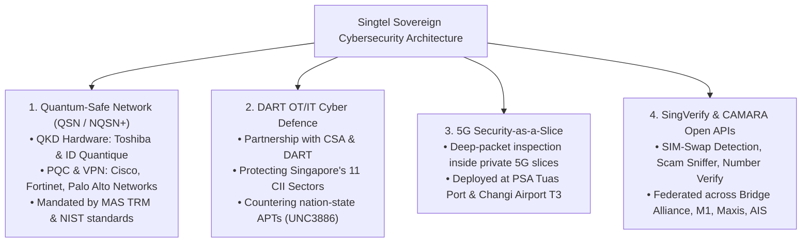
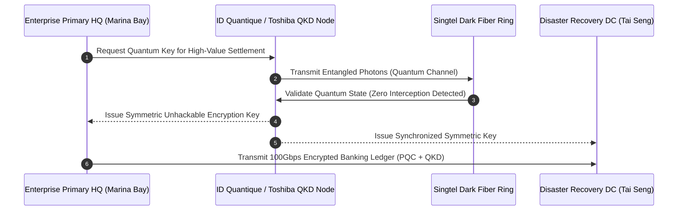

# Singtel: Comprehensive Cybersecurity Deep Dive Dossier

**Document Code:** SGT-INTEL-05-CYBER  
**Classification:** Technical & Strategic Intelligence Briefing  
**Focus:** Quantum-Safe Networking (QSN), DART OT/IT Critical Infrastructure Defense, Trustwave Divestment, and Network Anti-Fraud APIs  

---

## 1. Executive Summary & Strategic Evolution

Singtel's cybersecurity strategy has undergone a profound transformation over the past decade. In 2015, Singtel attempted to become a global managed security service provider (MSSP) by acquiring US-based **Trustwave Holdings** for **US$810 Million**. However, severe integration challenges, intense North American competition, and cultural dissonance resulted in substantial losses, culminating in a S$336 Million impairment charge and the eventual **divestment of Trustwave in late 2023 for US$205 Million to MC2 Capital**.

Learning from this experience, Group CEO **Yuen Kuan Moon** and Singtel Singapore CEO **Ng Tian Chong** executed a complete strategic pivot. Instead of competing globally as an unbundled software MSSP, Singtel now focuses on **Sovereign, Network-Embedded Cybersecurity** across Asia-Pacific:
1. **Pioneering Quantum-Safe Infrastructure:** Deploying Southeast Asia's first commercial **Quantum-Safe Network (QSN / NQSN+)**, embedding **Quantum Key Distribution (QKD)** and **Post-Quantum Cryptography (PQC)** directly into its fiber pipes.
2. **Defending Singapore's 11 CII Sectors:** Co-developing the **DART OT/IT Cyber Defence Programme** with the **Cyber Security Agency of Singapore (CSA)** to harden critical energy, transport, banking, and healthcare assets against advanced persistent threats (such as **UNC3886**).
3. **5G Security-as-a-Slice:** Integrating zero-trust firewalls, intrusion detection, and encryption directly into 5G enterprise network slices.
4. **Federated Anti-Fraud APIs (SingVerify):** Monetizing telco network telemetry via GSMA CAMARA open APIs to prevent SIM-swap fraud and scam voice calls across regional banking systems.

---

## 2. National Quantum-Safe Network Plus (NQSN+) & Singtel QSN

### 2.1 The Quantum Threat Context
Modern global financial, government, and corporate communication relies on public-key cryptography (e.g., RSA-2048, ECC). The advent of cryptographically relevant quantum computers (CRQCs) threatens to break these encryption schemes, rendering current encrypted data vulnerable to "Harvest Now, Decrypt Later" (HNDL) attacks by nation-state actors. In response, the **Monetary Authority of Singapore (MAS)** issued industry advisories instructing banks to develop quantum-readiness roadmaps.

### 2.2 Singtel's Appointment & Architecture
In mid-2023, the **Infocomm Media Development Authority (IMDA)** formally appointed Singtel to engineer, deploy, and operate Singapore's nationwide **National Quantum-Safe Network Plus (NQSN+)**.

Singtel's QSN architecture integrates two complementary defense layers:
1. **Quantum Key Distribution (QKD) — Layer 1 Physics-Based Security:**
   * Utilizes quantum properties of light (photons) transmitted over dedicated dark fiber to exchange symmetric encryption keys.
   * Any attempt by an eavesdropper to intercept or measure the photon alters its quantum state, instantly corrupting the transmission and alerting network operators.
   * **Hardware Partners:** **ID Quantique (IDQ)** (integrating its *Clarion KX* key management platform) and **Toshiba** (deploying high-rate QKD optical appliances and testing with SpeQtral).
2. **Post-Quantum Cryptography (PQC) — Layer 2/3 Mathematical Algorithms:**
   * Software and firmware algorithms resistant to quantum cryptanalysis, aligned with newly ratified **U.S. National Institute of Standards and Technology (NIST)** standards (e.g., ML-KEM / Kyber, ML-DSA / Dilithium).
   * Deployed across existing enterprise routing and IPsec VPN infrastructure where dedicated QKD fiber is unavailable.
   * **Networking & Security Partners:**
     * **Palo Alto Networks:** Integrated PQC IPsec virtual private networks protecting high-throughput multi-cloud links.
     * **Fortinet:** Quantum-resistant next-generation firewalls (NGFW) and hardware-accelerated encryptors.
     * **Cisco:** Quantum-safe secure routing platforms.

### 2.3 Commercial Traction
* **Commercial Deals:** Singtel has closed **4 major commercial QKD and quantum-safe enterprise contracts** to date across banking, government, and defense infrastructure.
* **Quantum-Safe-as-a-Service (QSaaS):** Enables mid-market enterprises and financial institutions to buy quantum-safe protection as an elastic monthly add-on to their existing **Singtel CUBΣ** connectivity, avoiding heavy upfront appliance capex.

---

## 3. DART OT/IT Cyber Defence Programme & CII Protection

### 3.1 Defending Singapore's 11 Critical Information Infrastructure (CII) Sectors
Under the **Singapore Cybersecurity Act**, the government designated 11 critical sectors whose disruption would imperil national security, economic survival, or public health:
1. Energy (Power grids, LNG terminals)
2. Water (Water reclamation plants, desalination)
3. Banking & Finance (Payment gateways, MAS settlement rails)
4. Healthcare (Public hospitals, diagnostic labs)
5. Transport — Maritime (PSA Tuas Mega Port, Jurong Port)
6. Transport — Aviation (Changi Airport air traffic control, baggage hubs)
7. Transport — Land (SMRT/SBS transit networks)
8. Infocomm (Singtel, StarHub, NetLink Trust exchanges)
9. Media (National broadcast channels)
10. Security & Emergency Services (Police, SCDF 995/999 command centres)
11. Government (GovTech, national databases)

### 3.2 The Singtel-DART-CSA Collaboration
To defend these critical assets against sophisticated state-backed threat actors (such as **UNC3886** and **Volt Typhoon**), Singtel joined forces with the **Cyber Security Agency of Singapore (CSA)** and leading operational cybersecurity training provider **DART**:
* **The Platform:** Delivered through the **Singtel Cyber Security Institute (CSI)** in Singapore.
* **Curriculum Structure:**
  * **Information Technology (IT) Track:** Focuses on enterprise network architectures, advanced threat hunting, zero-day mitigation, memory-injection analysis, and breach containment.
  * **Operational Technology (OT) Track:** Focuses specifically on SCADA systems, programmable logic controllers (PLCs), industrial IoT sensors, and proprietary operational protocols governing water pumps, power turbines, and container cranes.
* **Hyper-Realistic Cyber Range:** Participants undergo intensive simulated attacks mirroring live nation-state playbooks (firmware backdoors, living-off-the-land techniques, lateral movement from corporate IT into industrial control networks), training engineering teams to detect and isolate intrusions without halting essential public services.

---

## 4. The Strategic Reset: Why Singtel Divested Trustwave

The sale of Trustwave in late 2023 represents a crucial strategic inflection point in Singtel's corporate history:

### 4.1 Chronology of the Acquisition and Divestment
* **April 2015:** Singtel acquires a 98% equity stake in Chicago-based **Trustwave Holdings, Inc.** for **US$810 Million** under former Group CEO Chua Sock Koong, aiming to create a global managed security powerhouse.
* **Operational Disconnect:** Trustwave's operations were heavily concentrated in North America and Europe, offering compliance, payment card industry (PCI) audits, and remote SOC services. Singtel struggled to achieve sales synergies with its core APAC connectivity customer base.
* **May 2021:** Under incoming CEO Yuen Kuan Moon, Singtel initiated a comprehensive strategic reset, recognizing that Trustwave was operating at continuous net losses. Singtel booked a **S$336 Million non-cash impairment charge** against Trustwave's goodwill.
* **October 2, 2023:** Singtel signed a conditional share purchase agreement to sell 100% of Trustwave to **MC2 Titanium, LLC** (an investment vehicle tied to The Chertoff Group) for an enterprise valuation of **US$205 Million**.
* **January 8, 2024:** Transaction officially completed.

### 4.2 Lessons Learned & Modern Playbook
The Trustwave divestment provided crucial strategic clarity for Singtel's enterprise leadership:
1. **Stick to Sovereign and Regional Strengths:** Global software-only cybersecurity is an intensely crowded, commoditized market dominated by specialized pure-play vendors (CrowdStrike, Palo Alto Networks, Zscaler). Singtel cannot out-innovate Silicon Valley software firms on pure endpoint software.
2. **Network-Embedded Security is Unassailable:** Singtel's true competitive moat lies in its **physical and logical network infrastructure**—the subsea cables, fiber backbones, 5G towers, and telco exchanges. By embedding security controls (QSN, 5G slicing, anti-fraud APIs) directly into the network transport layer, Singtel offers capabilities that software-only cybersecurity firms cannot replicate.

---

## 5. Network Anti-Fraud Telemetry: SingVerify & CAMARA Open Gateway

As financial scams and credential theft surged across Southeast Asia, Singtel operationalized its carrier network telemetry into enterprise security services:

### 5.1 SingVerify Open Network APIs
Built to the global **GSMA Open Gateway / CAMARA standard**, Singtel launched **SingVerify** to provide real-time, carrier-grade authentication directly to banks, fintechs, and government agencies:
* **SIM-Swap Detection API:** Queries Singtel's core Home Location Register (HLR) in milliseconds. If an executive or banking customer's SIM card was replaced within the past 48 hours (a common precursor to SMS 2FA hijacking), the bank automatically blocks high-value wire transfers.
* **Number Verify API:** Verifies the user's mobile number silently in the background over the cellular radio network, completely bypassing SMS OTPs and rendering phishing kits ineffective.
* **Device Location API:** Confirms whether the customer's physical mobile device is in the vicinity of an ATM or merchant card terminal during a transaction.
* **Scam Sniffer API:** Analyzes call routing patterns to flag international spoofed calls masquerading as local Singapore numbers.

### 5.2 Regional Federation
Singtel executed cross-carrier API federation agreements:
* **Domestic Federation:** Partnered with rival telco **M1** so developers can access identical APIs covering >70% of Singapore's mobile subscribers via a single integration.
* **Regional Federation:** Extended federation to **Maxis** in Malaysia and **AIS** in Thailand via the **Bridge Alliance**, enabling regional banks (such as DBS, OCBC, UOB, Maybank) to protect cross-border payments across the Singapore-Malaysia-Thailand corridor.
