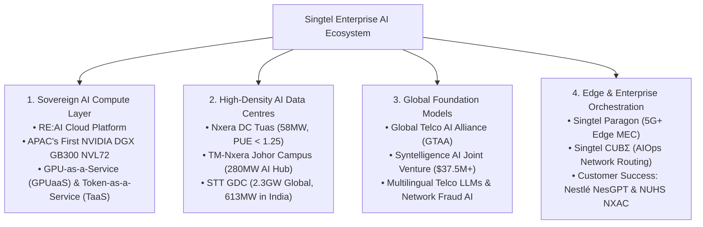
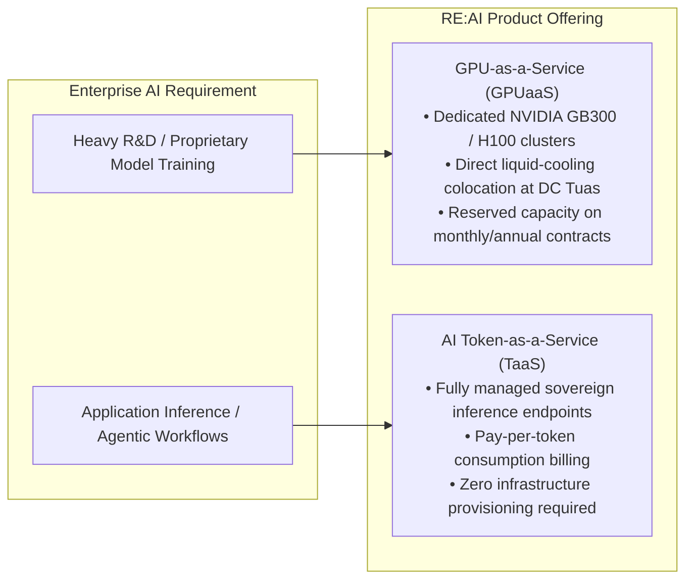
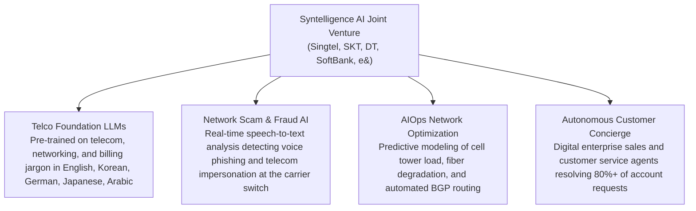

# Singtel: Comprehensive Artificial Intelligence Deep Dive Dossier

**Document Code:** SGT-INTEL-06-AI  
**Classification:** Technical & Strategic Intelligence Briefing  
**Focus:** RE:AI Sovereign Cloud, NVIDIA DGX GB300 Deployment, Token-as-a-Service (TaaS), Nxera AI Data Centres, and Global Telco AI Alliance  

---

## 1. Executive Summary & The AI Pivot

Artificial Intelligence is the centerpiece of Singtel's **Singtel28 (ST28)** strategy. Under Group CEO **Yuen Kuan Moon** and Digital InfraCo CEO **Bill Chang**, Singtel is executing an ambitious strategy to establish itself as the premier **AI Infrastructure, Compute, and Orchestration Hub for Southeast Asia and the wider Asia-Pacific region**.

Rather than attempting to build proprietary general-purpose frontier LLMs to compete directly with OpenAI or Google, Singtel has positioned itself strategically across the **critical bottleneck layers of the enterprise AI value chain**:
1. **Sovereign AI Compute Infrastructure (RE:AI & GPUaaS):** Providing enterprise and government customers with dedicated access to cutting-edge NVIDIA GPU clusters hosted in Singapore and regional data centers under strict domestic data residency.
2. **AI Token-as-a-Service (TaaS):** Lowering barriers to enterprise AI adoption by delivering consumption-based token billing for top-tier foundation models without requiring clients to provision physical GPU hardware.
3. **Next-Generation Liquid-Cooled AI Data Centres (Nxera & STT GDC):** Scaling a regional footprint exceeding **2.5 Gigawatts (GW)** across Singapore, Malaysia, and India designed specifically for high-density AI clusters (>100kW per rack).
4. **Domain-Specific Telco Foundation Models (GTAA / Syntelligence AI):** Co-founding the Global Telco AI Alliance with **SK Telecom**, **Deutsche Telekom**, **e&**, and **SoftBank** to create multilingual telco-specialized AI models.
5. **Edge AI Orchestration (Singtel Paragon):** Linking enterprise 5G network slicing directly to edge computer vision and robotics applications in ports, airports, hospitals, and smart factories.

---

## 2. RE:AI — Singtel's Sovereign AI Cloud

### 2.1 Strategic Rationale: The Sovereignty Moat
Enterprises and government institutions across Southeast Asia face significant challenges when adopting AI:
* **Data Sovereignty & Privacy Mandates:** Laws such as Singapore's **Personal Data Protection Act (PDPA)**, the **Cybersecurity Act**, **MAS TRM Guidelines**, and India's **DPDP Act 2023** strictly regulate the cross-border transfer of sensitive personal, financial, and healthcare data. Sending corporate IP or customer data to overseas hyperscaler API endpoints introduces legal and regulatory risk.
* **GPU Capacity Bottlenecks:** Access to top-tier NVIDIA GPU silicon remains constrained, with hyperscalers prioritizing massive US technology firms.
* **Cost Predictability:** Uncontrolled API token consumption on foreign cloud platforms leads to unpredictable enterprise IT operational expenditure.

Singtel launched **RE:AI** (spearheaded by Bill Chang) to address these friction points by providing high-performance, sovereign AI infrastructure located entirely within Singapore's physical borders.

### 2.2 First in APAC: NVIDIA DGX GB300 NVL72 Deployment
* **Milestone:** In late 2024 / 2026, Singtel announced that RE:AI became the **first cloud provider in the Asia-Pacific region to deploy next-generation NVIDIA DGX GB300 systems**, expanding on its existing NVIDIA H100 and GB200 infrastructure.
* **Architecture:** The DGX GB300 NVL72 rack-scale architecture features 72 Blackwell GPUs interconnected via NVLink into a single massive GPU domain, delivering up to **30x faster real-time LLM inference** and dramatic energy efficiency improvements compared to preceding architectures.
* **Target Workloads:** Massive multi-modal AI reasoning, autonomous agentic workflows, complex financial quantitative simulations, and medical imaging diagnostics.

### 2.3 Product Portfolio: GPUaaS vs. Token-as-a-Service (TaaS)

1. **GPU-as-a-Service (GPUaaS):**
   * Designed for enterprise R&D departments, banks, and biomedical labs training or fine-tuning models on proprietary data.
   * Hosted in dedicated, air-gapped server racks inside **Nxera DC Tuas**, connected via ultra-low-latency 400Gbps/800Gbps InfiniBand fabrics.
2. **AI Token-as-a-Service (TaaS):**
   * Launched in October 2024 / 2026 to democratize AI adoption for mid-market enterprises and SMEs.
   * Enterprises connect their internal applications directly to RE:AI's sovereign API endpoints, paying only for the tokens consumed.
   * Completely mitigates the infrastructure management overhead and hardware obsolescence risks of purchasing physical GPU servers.

---

## 3. Nxera & STT GDC: Regional AI Data Centre Dominance

AI workloads require unprecedented power density (often exceeding **50kW to 100kW+ per rack**), which legacy air-cooled data centers cannot physically support without experiencing thermal throttling. Singtel has engineered its data centre footprint to dominate high-density AI hosting:

### 3.1 Nxera DC Tuas (Singapore — 58MW)
* **Design:** Singtel's flagship hyperscale, AI-ready data centre in Western Singapore.
* **Power & Efficiency:** 58 Megawatts total IT capacity; target Power Usage Effectiveness (PUE) **< 1.25**, making it one of the most sustainable data centres in the tropics.
* **Advanced Cooling:** Built-in direct liquid-to-chip cooling loops and rear-door heat exchangers capable of cooling dense NVIDIA DGX GB300 racks dissipating >120kW per footprint.

### 3.2 TM-Nxera Johor AI Campus (Malaysia — 280MW)
* **Joint Venture:** 51% Telekom Malaysia, 49% Singtel Nxera.
* **Strategic Positioning:** Located in Iskandar Puteri inside the **Johor-Singapore Special Economic Zone (JS-SEZ)**, directly connected to Singapore via diverse subsea and terrestrial dark fiber rings.
* **Power Agreement:** Secured a multi-year power agreement with **Tenaga Nasional Berhad (TNB)** for **280MW** of high-voltage industrial power.
* **Corridor Synergy:** Solves Singapore's physical land and power constraints by allowing enterprises to run heavy AI training clusters across the causeway in Johor while accessing low-latency inference nodes in Singapore.

### 3.3 The S$13.8 Billion STT GDC Acquisition
Through its consortium with **KKR**, Singtel acquired a 25% ownership stake in **ST Telemedia Global Data Centres (STT GDC)**, creating an unmatched regional colocation empire:
* **Global Footprint:** Over **2.3GW** of operational and pipeline data centre capacity across 11 countries.
* **Indian Market Dominance:** **34 operational data centres across 10 major Indian cities** (Mumbai, Bengaluru, Chennai, Delhi NCR, Pune, Hyderabad, Kolkata, Ahmedabad), comprising **613MW of IT capacity**, including a newly commissioned 22MW AI data centre in Noida.
* **Cross-Border Advantage:** Singtel is the only operator capable of providing Singaporean enterprises with a unified, single-contract data centre and connectivity footprint bridging **Singapore (DC Tuas)**, **Malaysia (TM-Nxera Johor)**, and **India (STT GDC + Bharti Airtel)**.

---

## 4. Global Telco AI Alliance (GTAA) & Syntelligence AI

### 4.1 Genesis of the Alliance
Recognizing that individual telecommunications operators lack the scale to compete against global Big Tech AI ecosystems independently, Singtel formed the **Global Telco AI Alliance (GTAA)** alongside four tier-1 global operators:
* **SK Telecom** (South Korea)
* **Deutsche Telekom** (Europe / US)
* **e& Group** (Middle East / Africa)
* **SoftBank Corp.** (Japan)
* **Singtel Group** (Southeast Asia / Australia)

Combined, the alliance serves **over 1.3 Billion mobile and enterprise customers** across more than 50 countries.

### 4.2 The Syntelligence AI Joint Venture
In mid-2024, the members formalized their operational execution by establishing a commercial joint venture named **Syntelligence AI**, backed by an initial **US$37.5 Million** investment round.

---

## 5. Enterprise Case Studies & Edge AI Deployments

Singtel's AI capabilities are actively deployed in production across major enterprise environments:

### 5.1 Nestlé: Global Backbone for NesGPT
* Singtel modernised Nestlé's global communications backbone across 100+ countries and 1,700 sites using **Singtel CUBΣ**.
* The resilient, low-latency network infrastructure serves as the high-throughput pipeline powering **NesGPT**, Nestlé's internal generative AI platform used by over 80,000 employees globally for recipe formulation, marketing ideation, and supply chain management.

### 5.2 National University Health System (NUHS) & Ericsson: NXAC
* Established the **National University XG AI Centre (NXAC)** on November 3, 2026.
* Tests 5G-Advanced and 6G hospital AI applications, including autonomous delivery robotics, ambient spatial patient monitoring, and remote augmented-reality (XR) surgical guidance orchestrated over dedicated 5G network slices.

### 5.3 Internal AI Transformation (AIOps & Customer Service)
* **Contact Centre GenAI:** Singtel integrated GenAI into its customer service and enterprise support hubs, automating tier-1 issue resolution and reducing average customer handle times by over 25%.
* **Predictive AIOps:** Machine learning algorithms continuously monitor optical fiber power levels, router CPU loads, and packet jitter across domestic and subsea cables, automatically triggering predictive rerouting before link degradation impacts enterprise customer SLAs.
