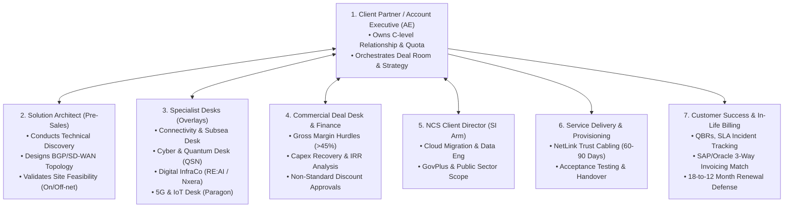
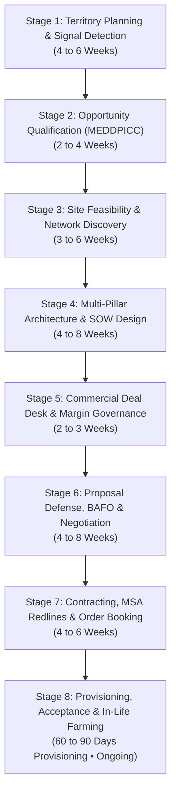
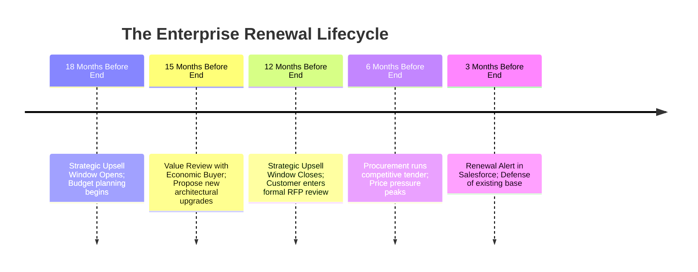

# Telco B2B Enterprise Sales: Organizational Structure, Sales Cycles & Operational Mechanics

**Document Code:** SGT-INTEL-07-SALES-OPS  
**Classification:** Strategic Sales Operations & Field Enablement Masterclass  
**Focus:** Frontline Sales Roles, The 8-Stage B2B Telco Sales Cycle, Deal Desk Economics, MEDDPICC Governance, and Singtel Enterprise Operational Realities  

---

## 1. Executive Summary: The Reality of B2B Telco Enterprise Selling

Selling enterprise telecommunications and digital infrastructure is fundamentally different from transactional B2B software (SaaS) or consumer telecom:
* **Capital-Intensive Physical Foundations:** Every deal ultimately connects to physical reality—underground optical fiber ducts, building entry risers, switch ports, radio spectrum, and data centre power racks.
* **Extreme Deal Complexity:** Annual Recurring Revenue (ARR) ranges from **SGD 100,000 to SGD 10,000,000+**, with contract durations spanning **24 to 60 months** and Total Contract Values (TCV) routinely reaching tens of millions of dollars.
* **Extended Sales Cycles:** Enterprise telecom sales cycles range from **6 to 18 months**, governed by complex technical evaluations, physical site feasibility surveys, regulatory compliance audits, and multi-layered procurement tenders.
* **The Multidisciplinary "Sales Squad":** An individual salesperson cannot sell telco infrastructure alone. Success requires orchestrating a matrixed team spanning technical architects, product overlay specialists, commercial deal desk controllers, regulatory lawyers, and physical service delivery managers.

---

## 2. Telco Enterprise Sales Roles & Responsibilities

In tier-1 telecommunications operators like **Singtel**, **AT&T**, **Orange Business**, or **Telstra**, enterprise accounts are managed through a formalized hierarchy:

| Role Title | Primary Function & Quota | Typical Daily Focus | Key Pain Points |
| :--- | :--- | :--- | :--- |
| **Client Partner (CP) / Global Account Director (GAD) / Account Executive (AE)** | Relationship quarterback and commercial owner. Carries an annual quota of **SGD 2.0M to SGD 8.0M ARR** (or SGD 10M–30M TCV). | Executive stakeholder mapping (CFO, CIO, CISO), opportunity qualification, contract negotiation, and overall account revenue growth. | Spends **4+ hours per week** manually digging through external news, LinkedIn, and CRM records; dealing with internal divisional silos. |
| **Solution Architect (SA) / Pre-Sales Consultant** | Technical authority. Partnered 1:2 or 1:3 with AEs. No direct quota, evaluated on technical win rate. | Discovery workshops, auditing customer WAN/LAN diagrams, designing high-availability topologies, and authoring technical Statements of Work (SOWs). | Bottlenecked by manual site surveys; managing complex vendor interop (Cisco, Fortinet, Palo Alto). |
| **Product Sales Specialist (PSS) / Desk Specialist** | Overlay subject matter experts for complex growth pillars (e.g., Cyber/QSN, AI Cloud/RE:AI, 5G Paragon). | Deep-dive presentations, sizing GPU compute clusters, scoping sovereign compliance, and running Proof-of-Concepts (PoCs). | Competing for the AE's attention; incentives sometimes misaligned with core connectivity sales. |
| **Bid / Tender Manager** | Project manages high-stakes enterprise and government RFPs (Requests for Proposal). | Assembling compliance matrices, coordinating responses across 10+ internal departments, and ensuring deadline adherence. | Dealing with incomplete inputs from technical desks; managing 500-page tender documents. |
| **Commercial Deal Desk Manager** | Gatekeeper of group profitability and financial governance. | Calculating deal margins, Internal Rate of Return (IRR), payback periods on lateral fiber builds, and approving non-standard pricing. | Pressured by sales to discount; pressured by CFO to protect 50%+ gross margin targets. |
| **NCS Client Director (Singtel Group Specific)** | Heads digital transformation and systems integration lots. | Oversees software engineering, SAP/cloud migration, and data pipelines for public sector or MNC contracts. | Ensuring Singtel and NCS present a seamless, single-face proposal rather than competing. |
| **Service Delivery Manager (SDM) / Provisioning Engineer** | Post-sale execution owner. | Circuit provisioning, scheduling NetLink Trust civil works, installing customer-premises equipment (CPE), and SLA burn-in testing. | Physical delays (trenching permits, building riser access); customer escalation on 60–90 day lead times. |
| **Customer Success Manager (CSM) / Billing Specialist** | In-life retention, operational health, and invoice management. | Quarterly Business Reviews (QBRs), monitoring SLA uptime, resolving billing disputes, and managing credit notes. | Unresolved billing friction destroys sales momentum during contract renewals. |

---

## 3. The 8-Stage B2B Telco Enterprise Sales Cycle

The typical enterprise sales cycle spans **6 to 12 months** (and up to 18 months for multi-million-dollar government or global banking tenders).

### Stage 1: Territory Planning & Signal Detection
* **Hunting (New Logos):** Account Executives research target enterprise databases (e.g., Indian MNCs setting up regional HQs in Singapore, logistics firms opening automated warehouses in Tuas, fintechs expanding cross-border payment nodes).
* **Farming (Existing Customer Growth):** Account Executives monitor contract expiration dates (the **18-to-12-month renewal window**) and track infrastructure utilization alerts (e.g., bandwidth link saturation, jitter alarms).
* **The SingTech Advantage:** Replaces hours of manual web scraping and LinkedIn scouring by automatically flagging verified business signals (expansions, hiring surges, funding, regulatory mandates).

### Stage 2: Opportunity Qualification via MEDDPICC
Telco sales teams qualify multi-million-dollar opportunities using the **MEDDPICC** framework:
1. **Metrics (M):** What economic outcome does the customer expect? (e.g., "Reduce cross-border financial settlement latency from 4.2ms to <1.5ms", or "Eliminate SGD 150,000 in monthly hyperscaler egress fees").
2. **Economic Buyer (E):** Has the rep engaged the person who controls the discretionary budget? (Usually the Group CFO, COO, or VP of Global Infrastructure; rarely the IT manager).
3. **Decision Criteria (D):** What are the explicit technical, operational, and commercial requirements? (e.g., MAS TRM compliance, 99.999% SLA, carrier-neutral BGP failover).
4. **Decision Process (D):** What governance steps must occur? (e.g., Technical evaluation -> Risk Committee approval -> Procurement committee sign-off).
5. **Paper Process (P):** How does legal, procurement, and billing work? (e.g., MSA amendment timeline, Oracle/SAP vendor code onboarding).
6. **Identify Pain (I):** What is the quantified operational bottleneck? (e.g., "Our Pasir Panjang warehouse experienced an uncredited 4-hour partner tail outage during peak container unlading").
7. **Champion (C):** Who inside the client organization actively advocates for Singtel when the sales rep is not in the room? (e.g., Head of Network Engineering who wants CUBΣ automation).
8. **Competition (C):** Which alternative carriers or architectures are being evaluated? (e.g., StarHub, M1, SPTel, or cloud direct fabrics like Megaport).

### Stage 3: Site Feasibility (On-Net, Near-Net, Off-Net)
Unlike pure cloud software, telecommunications infrastructure requires **physical reachability analysis**:
* **On-Net Sites:** The building already has Singtel optical fiber terminated in the basement telecom equipment room (MDF). Standard lead times (15–30 days) apply; zero civil construction cost.
* **Near-Net Sites:** Singtel fiber runs along the street outside, but a physical "lateral build" (digging a trench, installing sub-ducts, and pulling fiber into the building riser) is required. Requires an engineering site survey, civil permit applications, and capital expenditure (SGD 10,000–SGD 50,000).
* **Off-Net Sites:** Singtel has no physical infrastructure near the facility (common for overseas sites in Johor, Mumbai, or regional industrial parks). Singtel must lease a "partner tail circuit" from a local carrier (e.g., Telekom Malaysia, Bharti Airtel, or Tata Communications). Partner tails carry higher costs and strict SLA carve-outs.

### Stage 4: Multi-Pillar Architecture & SOW Design
* The Solution Architect audits existing network configurations, data flows, and security policies.
* Rather than pitching commodity bandwidth, top telco sales teams design **integrated outcome bundles**:
  * Combining **Optical Fiber Connectivity** + **Singtel CUBΣ SD-WAN** + **Managed SASE / Cyber Security** + **Quantum-Safe Encryption (QSN)**.
* Prepares the detailed technical Statement of Work (SOW) defining demarcation points, equipment racks, router models, and SLA commitments.

### Stage 5: Commercial Deal Desk & Margin Governance
Telco sales reps cannot independently set pricing. Every non-standard enterprise quote must pass through the **Deal Desk**:
* **Capex Recovery Analysis:** If the customer requires Singtel to dig fiber or provide SGD 100,000 in managed Cisco/Fortinet hardware, the Deal Desk calculates the **Payback Period** (must be <18 months on a 36-month contract).
* **Gross Margin Hurdles:**
  * Owned On-Net Fiber: Target Gross Margin **60% to 75%**.
  * Managed Services & Cloud Orchestration: Target Gross Margin **40% to 55%**.
  * Third-Party Partner Tails & Colocation: Target Gross Margin **20% to 30%**.
  * Hardware Reselling: Target Gross Margin **10% to 15%**.
* **Blended Deal Hurdle:** The total contract must maintain a blended gross margin exceeding **45%**; otherwise, it requires executive escalation to the Managing Director of Enterprise.

### Stage 6: Proposal Defense, BAFO & Tender Negotiations
* The sales squad presents the formal commercial and technical proposal to the client's executive committee.
* **Procurement Negotiations:** Procurement conducts competitive benchmarking against StarHub or M1, requesting a **BAFO (Best and Final Offer)**.
* **Value Defense:** Top AEs defend pricing not by offering raw bandwidth discounts, but by demonstrating lower Total Cost of Ownership (TCO) through integrated security, automated CUBΣ management, and carrier-grade SLAs.

### Stage 7: Contracting, MSA Redlines & Order Booking
* Legal teams negotiate the **Master Services Agreement (MSA)** and **Service Level Agreement (SLA)**.
* **Key Redlining Battlegrounds:**
  * **Service Credit Caps:** Telcos push to cap outage credits at 15%–30% of monthly charges; enterprise banks push for 100% or consequential damages.
  * **Data Privacy & Compliance:** Ensuring alignment with Singapore's PDPA, India's DPDP Act, and MAS TRM guidelines.
  * **Termination for Convenience:** Enterprise demands exit clauses; telco enforces early termination liabilities.
* Upon signature, the AE updates the Opportunity in Salesforce to **Closed-Won**, triggering order fulfillment.

### Stage 8: Provisioning, Acceptance Testing & In-Life Farming
* **The Physical Delivery Phase (60 to 90 Days):**
  * Ordering local loops from NetLink Trust.
  * Dispatching technicians to install optical network terminals and enterprise firewalls.
  * Conducting 24-hour RFC 2544 bit-error-rate and latency burn-in testing.
* **Billing Handover:** Billing begins once the customer signs the Service Acceptance Form.
* **In-Life Farming:** The AE and Customer Success Manager conduct Quarterly Business Reviews (QBRs), monitor network telemetry on CUBΣ, and initiate expansion pitches as the client approaches the 18-to-12-month renewal window.

---

## 4. The 18-to-12 Month Renewal Window Strategy

Enterprise telecommunications contracts operate on a strict timing cycle:

* **Why 18 to 12 Months Out?** Inside 12 months, enterprise IT departments are locked into formal procurement guidelines. Procurement takes over the account, issues competitive RFPs to rival telcos (StarHub, M1, NTT), and forces a commodity price war.
* **The Proactive Window (12 to 18 Months):** The enterprise CIO is actively planning the next fiscal year's IT capital budget. The Singtel AE can pitch an outcome-based digital transformation bundle (e.g., migrating to **Singtel CUBΣ + Quantum-Safe Network + RE:AI TaaS**) and have it baked directly into the customer's upcoming budget, locking out competitors before an RFP is ever issued.

---

## 5. How Singtel Enterprise Operates: Leadership & Structure

Under Group CEO **Yuen Kuan Moon** and Singtel Singapore CEO **Ng Tian Chong**, the B2B enterprise sales organization is led by **Lim Seng Kong**, Managing Director of Enterprise.

### 5.1 Account Segmentation & Go-to-Market Desks
1. **Global & Key Accounts (Named MNCs):** Dedicated Global Account Directors (GADs) managing Forbes Global 500 multinationals (e.g., Nestlé, global investment banks, pharmaceutical giants) across multi-country footprints.
2. **Public Sector & Critical Infrastructure (with NCS):** Joint go-to-market squads managing GovTech, Ministry of Defence, public healthcare clusters, and Singapore's 11 Critical Information Infrastructure (CII) sectors.
3. **Large Local Enterprises (LLEs):** Focuses on Singapore-headquartered regional conglomerates (CapitaLand, PSA, Keppel, Singapore Airlines).
4. **Mid-Market & Commercial Enterprise:** Verticalized sales pods focusing on high-growth manufacturing, regional logistics, and fintech firms.

### 5.2 The System of Record: Salesforce & Chatter Deal Rooms
Singtel’s enterprise sales organization operates entirely within **Salesforce CRM**:
* **Opportunity Records:** Track deal progression across standard enterprise stages (Prospecting -> Discovery -> Solution Scoping -> Proposal -> Negotiation -> Closed-Won).
* **Chatter Deal Rooms:** The internal collaboration hub where the Client Partner coordinates with Solution Architects, Connectivity specialists, Cyber experts, and NCS directors.
* **The Manual Friction Problem:** Reps spend hours re-typing company filings, copying network telemetry from CUBΣ, and searching job boards for hiring signals.
* **The SingTech Solution:** SingTech acts as an intelligent co-pilot sitting atop Salesforce, automatically synthesizing signals, drafting pre-cleared executive briefs, calculating bundle ARR, and syncing records with one click.
