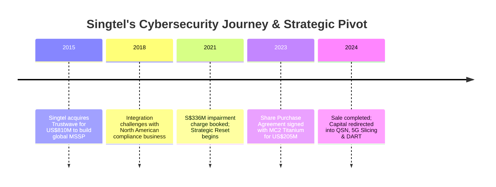

# Singtel Completes Sale of Trustwave to MC2 Titanium for US$205 Million, Concluding Cybersecurity Portfolio Restructuring

**Source:** Singtel SGX Announcement / Reuters / Capacity Media  
**Date:** 8 January 2024  
**Keywords:** Singtel, Trustwave, MC2 Capital, Divestment, Strategic Reset, Capital Recycling, Cybersecurity  

---

## Article Summary
Singapore Telecommunications Limited (Singtel) has formally completed the divestment of its 100% equity stake in Chicago-headquartered cybersecurity services provider **Trustwave Holdings, Inc.** to **MC2 Titanium, LLC** (an investment vehicle affiliated with The Chertoff Group).

The transaction, originally announced in October 2023, closed at an implied enterprise value of **US$205 Million**, consisting of upfront cash and a secured note. The completion marks the final chapter in Singtel’s strategic review of non-core global digital assets, enabling the group to refocus its cybersecurity capital entirely on **sovereign, network-embedded security solutions across the Asia-Pacific region**.

---

## Historical Context & Strategic Rationale

### 1. The 2015 Acquisition vs. Market Realities
In April 2015, under former Group CEO Chua Sock Koong, Singtel acquired a 98% stake in Trustwave for approximately **US$810 Million** to capture the booming international managed security market. 
* However, Trustwave's operations were heavily anchored in North America and Europe, centered around commoditized Payment Card Industry (PCI) compliance audits and remote Security Operations Centre (SOC) management.
* The expected commercial synergies with Singtel’s core Asia-Pacific telecommunications customer base failed to materialize. Meanwhile, rapid cloud migration and the rise of pure-play SaaS security vendors (such as CrowdStrike and Palo Alto Networks) eroded Trustwave’s traditional enterprise margins.

### 2. Impairment & Strategic Review
In May 2021, incoming Group CEO **Yuen Kuan Moon** conducted a rigorous review of group assets. Singtel booked a **non-cash impairment charge of S$336 Million** against Trustwave’s carrying value and placed the subsidiary under formal strategic evaluation.

### 3. Capital Recycling & The New Cybersecurity Blueprint
The sale of Trustwave directly advances Singtel’s capital recycling program, which has unlocked over S$8 Billion in liquidity to self-fund high-growth initiatives:
* **The New Focus:** Rather than competing globally as an unbundled software MSSP, Singtel has redirected its security investments into **capabilities tightly coupled to its physical and logical network infrastructure in Asia**:
  * **Singtel Quantum-Safe Network (QSN / NQSN+):** In partnership with IMDA, Toshiba, and ID Quantique.
  * **Critical Infrastructure OT/IT Cyber Defence:** In partnership with CSA and DART, protecting Singapore's 11 critical sectors.
  * **5G Security-as-a-Slice & SingVerify APIs:** Directly monetizing cellular network telemetry for fraud prevention.
