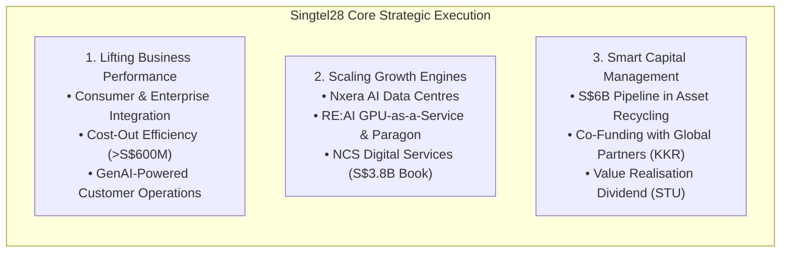

# Singtel Unveils Singtel28 (ST28): Strategic Growth Plan Focused on AI Infrastructure, Operational Synergies, and S$6 Billion Asset Recycling

**Source:** Singtel Corporate Newsroom / SGX Regulatory Filing  
**Date:** 23 May 2024  
**Keywords:** Singtel, ST28, Yuen Kuan Moon, Asset Monetisation, AI Infrastructure, GPUaaS, Nxera, Dividends  

---

## Article Summary
Singapore Telecommunications Limited (Singtel) has officially launched **Singtel28 (ST28)**, a comprehensive multi-year strategic roadmap designed to enhance customer experiences, expand high-growth digital infrastructure engines, and deliver sustained value realization for shareholders. 

ST28 succeeds the group's foundational "Strategic Reset" initiated in May 2021, marking a definitive evolution from organizational restructuring into aggressive scaling of enterprise technology, artificial intelligence, and regional digital infrastructure.

---

## Core Pillars of Singtel28 (ST28)

### Pillar 1: Lifting Core Business Performance
Building upon the corporate consolidation of its consumer and enterprise divisions across **Singtel Singapore** and **Optus Australia**, Singtel aims to drive substantial cost-out and operational productivity:
* **Cost Simplification:** Eliminating legacy product redundancies to target **S$600+ Million in group cost savings** over the ST28 horizon.
* **Capex Rationalization:** Lowering group core capital expenditure from 15% of revenue down to the **low teens** beyond FY26, as nationwide 5G standalone networks in Singapore reach full deployment maturity.
* **AI-First Operations:** Embedding Generative AI across digital touchpoints, customer care contact centres, and predictive network operations (AIOps).

### Pillar 2: Scaling High-Margin Digital Growth Engines
The group is channeling capital into two high-growth corporate engines:
1. **Digital InfraCo (Led by Bill Chang):**
   * Scaling **Nxera**, Singtel's regional green data centre arm, across Singapore (DC Tuas 58MW), Malaysia (TM-Nxera Johor 280MW), and Indonesia.
   * Pioneering sovereign AI compute across Asia-Pacific via **RE:AI**, offering commercial **GPU-as-a-Service (GPUaaS)** and **Token-as-a-Service (TaaS)** powered by next-generation NVIDIA architectures.
   * Monetizing subsea cable consortiums (SEA-ME-WE 6, Asia Link Cable) and commercializing **Singtel Paragon** for 5G+ network slicing and edge computing.
2. **NCS (Led by Ng Kuo Pin):**
   * Accelerating enterprise digital transformation across Asia-Pacific, with an active order book of **S$3.8 Billion**.
   * Expanding high-value *GovPlus*, *Telco+*, and *NEXT* cloud and cyber services across Singapore, Australia, and Southeast Asia.

### Pillar 3: Smart Capital Management & Asset Monetisation
* **S$8 Billion Capital Recycled (2021–2024):** The group successfully completed its initial S$8B capital recycling target by divesting non-core assets, including tower infrastructure in Australia, partial stakes in Bharti Airtel, and loss-making units (Trustwave).
* **New S$6 Billion Pipeline:** Singtel has identified a fresh **S$6 Billion pipeline in monetizable assets** to self-fund capital-intensive data centre and AI expansions without diluting shareholder equity or taking on excessive debt.
* **External Capital Co-Investment:** Partnering with premier global institutional investors, demonstrated by **KKR’s S$1.1 Billion investment into Nxera** for a 20% equity stake.
* **Shareholder Returns:** Introduced the **Singtel Value Realisation Dividend (STU)**—a sustainable dividend framework returning 3 to 6 cents per share annually funded directly by capital recycling proceeds.

---

## Executive Commentary
Speaking at the launch, Group CEO **Yuen Kuan Moon** stated:
> "Three years ago, our strategic reset set out to transform Singtel into a company focused on technology and connectivity. We simplified our portfolio, carved out Digital InfraCo, scaled NCS, and recycled S$8 billion in capital. 
> 
> Under ST28, we are moving decisively to lift the operational performance of our core business and capture the extraordinary enterprise demand for AI infrastructure, high-density data centres, and sovereign digital services. We are not just a telecommunications provider; we are the digital technology backbone for Asia's enterprise future."
