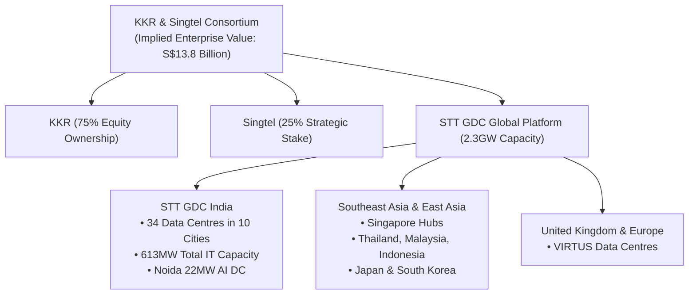

# Singtel and KKR Consortium Execute Landmark S$13.8 Billion STT GDC Data Centre Acquisition

**Source:** Singtel Corporate Announcements / SGX Filings / Financial Times  
**Date:** 18 June 2024 (Initial Investment) / Definitive Buyout Agreement  
**Keywords:** Singtel, KKR, STT GDC, Data Centres, AI Infrastructure, India, Nxera, M&A  

---

## Article Summary
A strategic consortium led by global investment powerhouse **KKR** and **Singtel** has entered into definitive agreements to complete the **S$13.8 Billion (US$10.9 Billion) full acquisition of ST Telemedia Global Data Centres (STT GDC)**, marking one of the largest digital infrastructure transactions in Asia-Pacific history.

The transaction builds upon an initial **S$1.75 Billion (~US$1.3 Billion)** investment announced in June 2024 via Redeemable Preference Shares with detachable warrants. Upon final completion, **KKR will hold a 75% majority interest**, while **Singtel will hold a 25% strategic equity stake** in STT GDC.

---

## Strategic Asset Footprint & Regional Significance

### 1. Massive 2.3GW Global Scale
STT GDC is one of the world’s fastest-growing data centre providers, operating a high-performance portfolio spanning:
* **Over 2.3 Gigawatts (GW)** of gross power capacity across 11 key international markets.
* Major operational campuses in Singapore, the United Kingdom, India, Thailand, South Korea, Indonesia, Japan, the Philippines, and Malaysia.

### 2. Critical India Footprint (613MW across 10 Cities)
Crucially for Singtel’s cross-border Singapore-India corridor strategy, **STT GDC India** is the undisputed market leader in the subcontinent:
* Operates **34 advanced data centre facilities across 10 tier-1 Indian cities**, including Mumbai, Bengaluru, Chennai, Delhi NCR, Pune, Hyderabad, Kolkata, and Ahmedabad.
* Represents **613 Megawatts** of critical IT capacity, serving major global cloud hyperscalers, multinational financial institutions, and fast-scaling Indian technology giants.
* Recently commissioned a flagship **22MW AI-dedicated data centre in Noida**, engineered specifically for high-density liquid cooling.

---

## Synergy with Singtel’s Nxera Platform
Singtel already operates its own regional green data centre arm, **Nxera**, in which KKR previously invested **S$1.1 Billion** for a 20% stake:
* **Complementary Architecture:** While Nxera focuses on high-density sovereign AI development (such as the 58MW DC Tuas in Singapore and the 280MW TM-Nxera campus in Johor), STT GDC provides unmatched geographic scale across India and Asia-Pacific.
* **Corridor Domination:** When combined with Singtel’s **27.5% stake in Bharti Airtel** and trans-oceanic subsea cable landings (SEA-ME-WE 6), Singtel becomes the only digital infrastructure operator capable of offering multinational enterprises a unified, single-contract colocation and low-latency network architecture connecting **Singapore, Malaysia, and India**.

---

## Executive Commentary
Arthur Lang, Singtel Group Chief Financial Officer, remarked:
> "Our partnership with KKR on STT GDC represents a transformative leap in Singtel’s digital infrastructure ambitions. In an era where Generative AI is driving unprecedented demand for compute capacity, this investment instantly propels Singtel into an elite global tier of data centre operators. 
> 
> By combining STT GDC’s expansive 2.3GW footprint with our own Nxera green data centres, RE:AI sovereign cloud, and subsea optical pipes, we are uniquely positioned to serve hyperscalers and enterprises throughout their regional AI journey."
