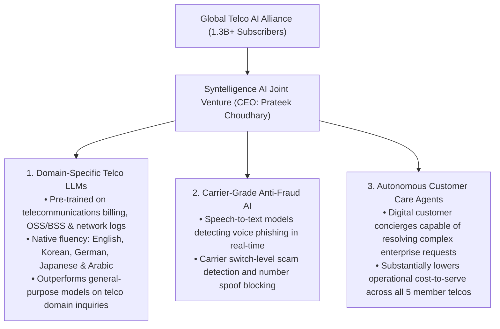

# Global Telco AI Alliance Formalizes US$37.5 Million Joint Venture "Syntelligence AI" to Build Industry-Specific LLMs

**Source:** Deutsche Telekom / SK Telecom / Singtel Joint Press Release  
**Date:** 19 June 2024  
**Keywords:** Global Telco AI Alliance, GTAA, Singtel, SK Telecom, Deutsche Telekom, SoftBank, e&, Syntelligence AI  

---

## Article Summary
The **Global Telco AI Alliance (GTAA)**—comprising founding telecommunications giants **Singtel Group**, **SK Telecom**, **Deutsche Telekom**, **e& Group**, and **SoftBank Corp.**—has officially signed a binding Joint Venture (JV) agreement to establish **Syntelligence AI**.

Backed by an initial multi-million dollar equity commitment (exceeding **US$37.5 Million**) equally split across the five founding telecommunications operators, the joint venture will be headquartered in London and Silicon Valley, led by Chief Executive Officer **Prateek Choudhary**. The entity is tasked with developing specialized, multilingual **Telco Large Language Models (LLMs)** and carrier-grade AI applications serving a combined global subscriber base of **over 1.3 Billion people across 50+ nations**.

---

## Strategic Objectives & Model Architecture

### 1. Solving the General-Purpose LLM Dilemma
General-purpose frontier models (such as GPT-4 or Claude 3.5) often struggle with telecommunications-specific vernacular, complex tariff structures, network operational troubleshooting (OSS/BSS), and regulatory compliance across diverse jurisdictions.
* **Syntelligence AI** fine-tunes foundation models on billions of domain-specific telecom tokens, creating specialized models that accurately understand technical telecommunications inquiries with lower latency and higher operational precision.
* **Multilingual Fluency:** Pre-trained natively in **English, German, Korean, Japanese, and Arabic**, ensuring localized performance across European, Asian, and Middle Eastern markets.

### 2. Network-Level Voice Scam & Phishing Eradication
Beyond customer service chatbots, the joint venture prioritizes carrier network security:
* Developing low-latency speech analysis models running at the telecommunications switchboard level to identify synthetic voice cloning, impersonation scams, and automated robocall campaigns in real time before calls connect to consumers or corporate executives.

---

## Executive Commentary
Yuen Kuan Moon, Singtel Group CEO, noted:
> "Telecom operators manage the most critical communications networks on the planet. By joining forces through Syntelligence AI, Singtel and our global alliance partners are creating specialized AI models that none of us could have built as efficiently in isolation. 
> 
> This alliance gives us the combined data diversity, technical talent, and global scale of 1.3 billion customers. For Singtel’s enterprise and consumer customers in Singapore and across our regional associates, this translates directly into smarter, automated networks and significantly enhanced protection against modern cyber threats and fraud."
