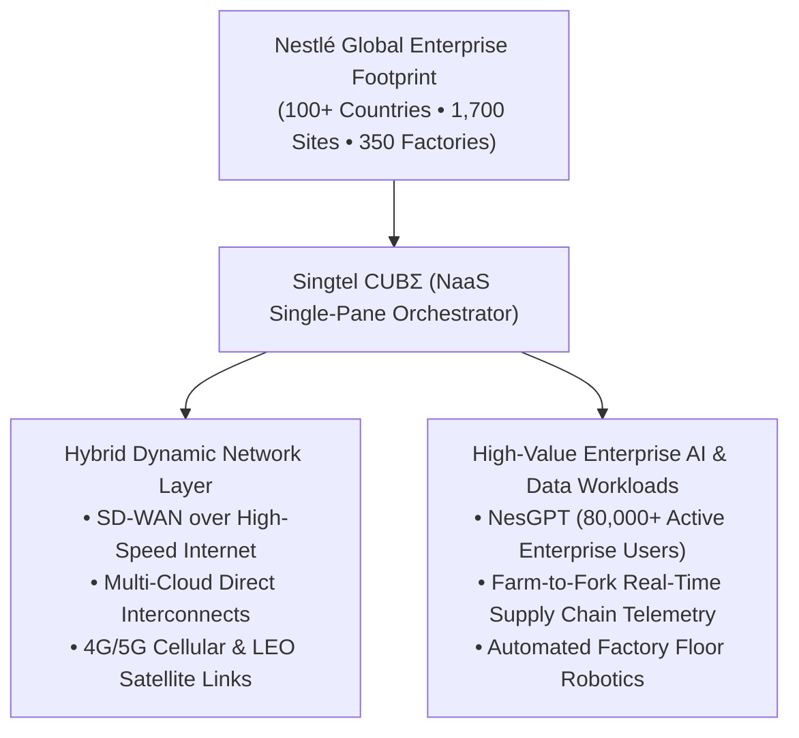

# Nestlé Selects Singtel CUBΣ for Multi-Year Global Network Modernisation Across 100+ Countries

**Source:** Singtel Enterprise Media Release / The Edge Singapore / Enterprise IT News  
**Date:** 20 August 2024  
**Keywords:** Singtel, Nestlé, CUBΣ, NaaS, SD-WAN, Cloud Interconnect, NesGPT, Global Enterprise  

---

## Article Summary
Global consumer food and beverage leader **Nestlé** (a Forbes Global 50 enterprise) has awarded **Singtel** a landmark multi-year contract to modernize its global communications infrastructure across **more than 100 countries**.

Under the agreement, Singtel will leverage its proprietary **Singtel CUBΣ (Cube)** Network-as-a-Service (NaaS) platform to transform Nestlé's legacy communications into an agile, cloud-centric, and software-defined network (SD-WAN). The infrastructure interconnects approximately **1,700 sites and over 350 manufacturing facilities worldwide**, providing the high-throughput digital foundation for Nestlé's real-time enterprise AI platforms, including **NesGPT**.

---

## Strategic Architecture & Scope of Transformation

### 1. The Challenge: Legacy MPLS Rigidity
Operating globally with hundreds of thousands of employees, Nestlé faced severe operational friction from traditional Multi-Protocol Label Switching (MPLS) circuits. Legacy private circuits were expensive, slow to provision (taking up to 3 months for new seasonal marketing sites or agricultural sourcing stations), and struggled to handle massive cloud-bound application traffic.

### 2. The Solution: Singtel CUBΣ NaaS Orchestration
Singtel CUBΣ serves as Nestlé IT's centralized digital command portal, providing:
* **Single Pane of Glass Control:** Orchestrates, monitors, and optimizes multi-vendor and multi-carrier circuits across all continents through one intuitive dashboard.
* **Dynamic Bandwidth-on-Demand:** Allows local Nestlé IT managers to scale network bandwidth up or down dynamically to support seasonal supply chain spikes or marketing campaigns.
* **Hybrid Transport Diversity:** Intelligently routes traffic over the optimal available path—switching seamlessly between dedicated optical internet, cellular 4G/5G, and Low Earth Orbit (LEO) satellite links for remote agricultural facilities.
* **40% Boost in Operational Efficiency:** Early deployment milestones demonstrated up to a **40% improvement in network routing performance** and cut branch provisioning times from months to mere hours.

### 3. Powering Enterprise Generative AI (NesGPT)
A primary driver for the network overhaul was Nestlé’s rollout of **NesGPT**—its internal, secure generative AI platform deployed to over 80,000 employees globally. NesGPT requires continuous, low-latency, and high-bandwidth data synchronization between distributed factory workstations, regional corporate headquarters, and centralized AI cloud inference nodes—a requirement fully fulfilled by Singtel's low-jitter optical routing.

---

## Competitive Significance for Singtel
Winning a Forbes Global 50 enterprise deal against entrenched European and American telecommunications incumbents (such as AT&T, Orange Business, and BT) validates Singtel's positioning:
* Proves that **Singtel CUBΣ** can successfully orchestrate complex, multinational IT environments across jurisdictions.
* Establishes a benchmark blueprint for Singtel sales teams to pitch global NaaS bundles to multinational corporations headquartered in Singapore and across Asia-Pacific.
