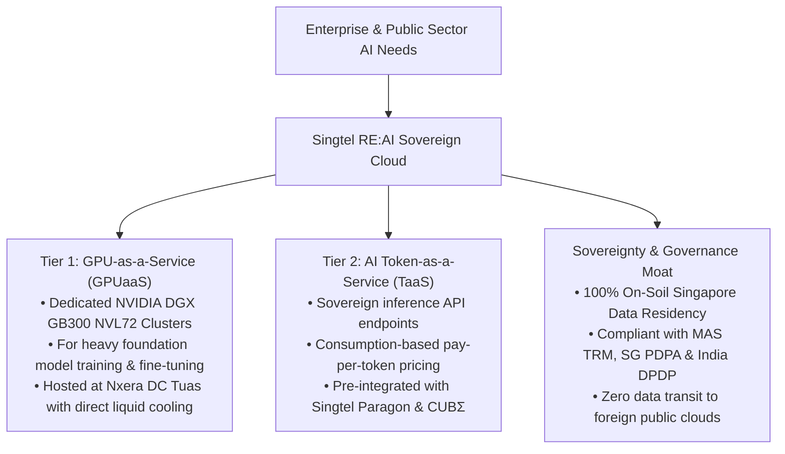

# Singtel’s RE:AI First in APAC to Deploy NVIDIA DGX GB300 Systems; Launches AI Token-as-a-Service (TaaS)

**Source:** Singtel Media Release / NVIDIA Partner Showcase  
**Date:** 28 October 2024  
**Keywords:** Singtel, RE:AI, NVIDIA, DGX GB300, Blackwell, GPUaaS, TaaS, Sovereign AI, Bill Chang  

---

## Article Summary
**Singtel’s RE:AI**, the sovereign AI cloud business operating under the group’s Digital InfraCo division, has announced that it is the **first cloud provider in the Asia-Pacific region to deploy next-generation NVIDIA DGX GB300 NVL72 systems**.

Building upon its earlier deployment of NVIDIA H100 and GB200 architectures, the integration of DGX GB300 establishes Singtel as the premier regional provider of enterprise-grade, liquid-cooled sovereign AI infrastructure. Simultaneously, Singtel officially commercially launched its **AI Token-as-a-Service (TaaS)** platform, designed to eliminate infrastructure barriers and democratize AI adoption for enterprises and public sector agencies.

---

## Key Technological & Commercial Capabilities

### 1. NVIDIA DGX GB300: High-Density Sovereign Compute
* **The Architecture:** Powered by NVIDIA Blackwell architecture, the DGX GB300 NVL72 integrates 72 Blackwell GPUs and 36 Grace CPUs into a single liquid-cooled rack acting as a giant unified GPU.
* **Performance Benchmark:** Delivers up to **30x faster real-time inference** for trillion-parameter AI models compared to previous-generation H100 systems, while drastically reducing power consumption per computation.
* **Liquid-Cooled Hosting at DC Tuas:** The clusters are hosted inside Singtel’s flagship **Nxera DC Tuas (58MW)** facility in Singapore, utilizing advanced direct liquid-to-chip cooling loops capable of managing thermal loads exceeding **100kW per server rack**.

### 2. AI Token-as-a-Service (TaaS): Elastic Enterprise Consumption
To address customer reluctance to commit millions of dollars upfront to reserved GPU clusters, Singtel launched **Token-as-a-Service (TaaS)**:
* **Consumption-Based Billing:** Enterprises access pre-deployed, optimized foundation models (including Llama 3, Mistral, and domain-specific telco models) hosted on RE:AI infrastructure, paying strictly for the tokens generated or processed.
* **Data Privacy Guarantee:** Guarantees that sensitive corporate data, customer records, and intellectual property remain strictly within Singapore’s sovereign jurisdiction, fully adhering to the **Personal Data Protection Act (PDPA)** and **MAS Technology Risk Management** requirements.
* **Orchestration via Singtel Paragon:** Enterprise applications can dynamically route inference requests through **Singtel Paragon**, orchestrating tasks across edge devices (such as smart port cameras or manufacturing sensors) and RE:AI GPU clusters in real time.

---

## Executive Commentary
Bill Chang, Chief Executive Officer of Singtel Digital InfraCo and Nxera, stated:
> "Sovereign AI is no longer a luxury—it is an economic and national imperative. Enterprises and governments cannot afford to outsource their sensitive data and intellectual capital to overseas clouds. 
> 
> By being the first in APAC to deploy NVIDIA's flagship DGX GB300 systems at Nxera DC Tuas, and introducing Token-as-a-Service, Singtel is democratizing high-performance AI. We are providing businesses of all sizes with immediate, scalable, and sovereign AI compute, backed by green energy and our ultra-low latency optical networks."
