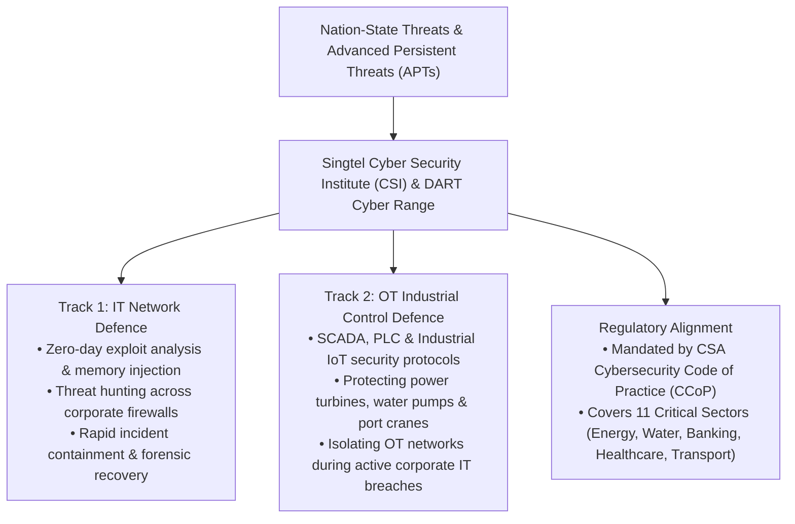

# Singtel, DART, and CSA Launch Specialized OT/IT Cyber Defence Programme to Protect Singapore's 11 Critical Sectors

**Source:** Singtel Cyber Security Institute / CSA Singapore / Telecompaper  
**Date:** 4 November 2024  
**Keywords:** Singtel, DART, CSA, OT Security, IT Security, Critical Information Infrastructure, CII, Cyber Range  

---

## Article Summary
The **Singtel Cyber Security Institute (CSI)**, in strategic collaboration with cybersecurity training specialist **DART** and aligned with national directives from the **Cyber Security Agency of Singapore (CSA)**, has launched the **Advanced Persistent Threat (APT) Detection and Response Programme**.

The program is engineered specifically to train and certify enterprise engineering teams defending Singapore's **11 Critical Information Infrastructure (CII)** sectors against sophisticated, state-sponsored cyber-espionage and sabotage campaigns targeting interconnected Information Technology (IT) and Operational Technology (OT) networks.

---

## Program Architecture & Realistic Cyber Range

### 1. Dual Specialized Tracks (IT & OT)
The 5-day intensive curriculum addresses the dangerous convergence between corporate enterprise IT networks and industrial OT machinery:
* **Information Technology (IT) Track:** Focuses on enterprise network architecture, deep-packet analysis, zero-trust endpoint containment, and threat hunting for stealthy backdoors and living-off-the-land techniques.
* **Operational Technology (OT) Track:** Focuses on industrial automation, Supervisory Control and Data Acquisition (SCADA) systems, Programmable Logic Controllers (PLCs), and proprietary industrial protocols governing water filtration facilities, maritime container cranes, power distribution stations, and airport baggage handling networks.

### 2. Live Cyber Range APT Simulations
The program culminates in high-pressure, simulated live cyberattack exercises on Singtel CSI’s state-of-the-art cyber range:
* Simulates real-world threat actor behaviors observed in regional critical infrastructure attacks (such as **UNC3886** and **Volt Typhoon**).
* Engineering teams must actively detect stealthy lateral movement from compromised corporate email servers into air-gapped industrial plant controllers, neutralizing threats without halting essential public utility or transport operations.

---

## Institutional Significance
Ng Tian Chong, Chief Executive Officer of Singtel Singapore, stated:
> "Critical information infrastructure owners face increasingly sophisticated, state-backed cyber threats designed to disrupt essential civilian services. Defending these assets requires specialized skills that span both enterprise cloud environments and physical industrial machines. 
> 
> Through our partnership with DART and close alignment with CSA, Singtel is helping build national cyber resilience, ensuring that Singapore's critical infrastructure operators possess the battle-tested capabilities needed to defend our essential national networks."
