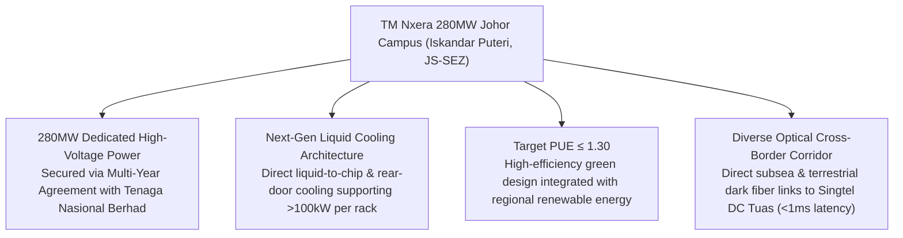

# TM Nxera Secures 280MW Power Supply Agreement with TNB for Flagship AI Data Centre Campus in Johor

**Source:** Telekom Malaysia Berhad / Singtel Investor Relations / Tenaga Nasional Berhad  
**Date:** 15 January 2026 (Agreement) / 2026 Milestones  
**Keywords:** TM Nxera, Singtel, Telekom Malaysia, Tenaga Nasional Berhad, Johor SEZ, AI Data Centre, 280MW  

---

## Article Summary
**TM Nxera Sdn Bhd**—the strategic data centre joint venture between **Telekom Malaysia (TM)** (51%) and **Singtel’s Nxera** (49%)—has officially executed a landmark Electricity Supply Agreement with Malaysia’s national power utility, **Tenaga Nasional Berhad (TNB)**, securing **280 Megawatts (MW)** of high-voltage industrial power for its mega AI-ready data centre campus in Iskandar Puteri, Johor.

Located within the **Johor-Singapore Special Economic Zone (JS-SEZ)**, the 280MW campus represents one of the largest and most technologically advanced sovereign digital infrastructure developments in Southeast Asia, engineered specifically to address the skyrocketing global compute requirements of Generative AI hyperscalers and multinational enterprises.

---

## Key Campus Specifications & Engineering Capabilities

### 1. Phased Development & Scalability
* **Total Campus Allocation:** 280 Megawatts across a multi-building hyperscale campus layout.
* **Initial Commercial Phase:** Scaled to deliver **64MW of immediate IT capacity**, with subsequent phases expanding beyond **200MW+**.
* **Timeline Milestones:** Following groundbreaking in July 2024, the consortium completed the structural **topping-out ceremony for Building 1 in April 2026**, keeping the facility on track for commercial tenant onboarding.

### 2. High-Density AI & Liquid-to-Chip Cooling
Traditional data centres in Southeast Asia operate at power densities of 5kW to 10kW per rack. The TM Nxera Johor campus is purpose-built for the extreme thermal demands of modern AI silicon (such as NVIDIA Blackwell and DGX GB300):
* Capable of dissipating **over 100kW per rack** utilizing closed-loop liquid-to-chip distribution manifolds.
* Maintains a rigorous design Power Usage Effectiveness (PUE) of **$\le 1.30$** at full operational load, optimizing water and electricity consumption in a tropical climate.

### 3. The Cross-Border "Twin-Campus" Advantage
The Johor campus is located approximately 25 kilometers from Singapore and is directly interconnected with Singtel’s **Nxera DC Tuas (58MW)** via dedicated, diverse dark fiber rings:
* **The Strategic Play:** Overcomes Singapore's strict physical land and national power allocation caps.
* **Corridor Architecture:** Multinational banks, AI laboratories, and sovereign enterprises can deploy their massive, energy-intensive model training clusters in Johor (benefiting from lower power and real estate tariffs) while simultaneously synchronizing real-time inference nodes and low-latency trading engines at DC Tuas in Singapore with **under 1 millisecond round-trip optical latency**.
