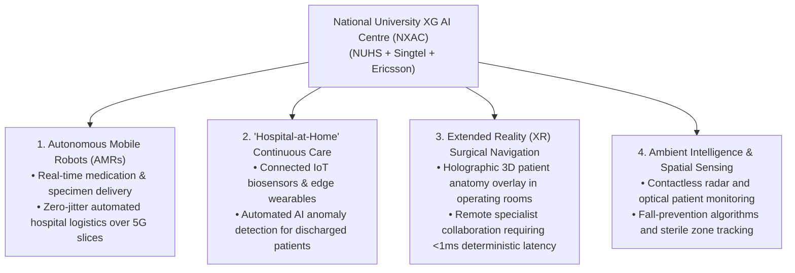

# NUHS, Singtel, and Ericsson Unveil World’s First 6G Healthcare AI Centre (NXAC)

**Source:** National University Health System (NUHS) / Singtel Press Office / Ericsson Asia-Pacific  
**Date:** 3 November 2026  
**Keywords:** NUHS, Singtel, Ericsson, NXAC, 5G-Advanced, 6G, Healthcare AI, Medical Robotics  

---

## Article Summary
In a world-first translational milestone for telecommunications and clinical medicine, the **National University Health System (NUHS)**, **Singtel**, and **Ericsson** have officially launched the **National University XG AI Centre (NXAC)** in Singapore.

The research and clinical development centre is the world's first healthcare facility dedicated to developing, testing, and validating artificial intelligence applications deployed over **5G-Advanced** and future **6G networks**. The "XG" moniker signifies the platform's multi-generational scope, designed to advance healthcare workflows from existing 5G slicing into ultra-low-latency 6G architectures.

---

## Real-World Clinical AI Testbed Applications

### 1. Autonomous Mobile Robots (AMRs) in Clinical Logistics
Fleet of autonomous indoor robotics operating over dedicated **Singtel Paragon 5G+ priority network slices** within the National University Hospital (NUH) campus. The dedicated slice guarantees that robot telemetry and navigation commands never compete with visitor Wi-Fi or administrative traffic, ensuring flawless medication, sterile instrument, and meals delivery across wards.

### 2. "Hospital-at-Home" Continuous Remote Patient Monitoring
Bridges the physical hospital environment with residential homes. High-risk post-surgical and chronic illness patients are monitored remotely using medical-grade wearables connected over cellular networks. AI models at the network edge continuously parse patient vital signs, alerting clinical rapid response teams before a patient experiences critical physiological deterioration.

### 3. Extended Reality (XR) Surgical Navigation
Surgeons in the operating theatre utilize lightweight augmented reality headsets streaming high-resolution 3D anatomical models superimposed directly onto the patient during complex surgeries. The procedure demands deterministic, sub-millisecond network latency and high bandwidth—capabilities delivered through Ericsson’s 5G-Advanced radio network and Singtel’s local edge compute.

---

## Commercial Significance for Singtel Enterprise Sales
The NXAC partnership serves as a flagship reference architecture for Singtel:
* Proves that **Singtel 5G+ Priority Slicing** is not a theoretical consumer gimmick, but a life-critical enterprise technology capable of replacing physical hospital cables.
* Provides a blueprint for Singtel enterprise sales teams to pitch **5G Healthcare Slicing + RE:AI Sovereign Cloud** bundles to private hospital networks (e.g., Parkway Pantai, Raffles Medical Group) and regional biomedical hubs across Asia-Pacific.
